# What the simulations show

Estimating the *cis*-heritability of gene expression, with three estimators that differ in what data they need and what they assume:

| estimator | data | assumption |
|---|---|---|
| **GCTA / REML** | individual-level genotypes | infinitesimal mixed model |
| **SuSiE** | summary statistics + LD | a *sparse* set of causal effects, $\hat h^2 = \sum(\mu_j^2 + \sigma_j^2)$ |
| **HEELS** | summary statistics + LD | infinitesimal mixed model |

The third arm is what makes the first two interpretable: HEELS shares SuSiE's *inputs* and GCTA's *model*, so a difference between SuSiE and GCTA can finally be attributed to one or the other.

Ground truth is never observable in real data, so everything below comes from simulation: **20,294 model fits** across **350 random 1000G EUR *cis*-regions** (±500 kb, median ~8,200 SNPs), where the true $h^2$ is set by construction. Every estimator sees the *same* simulated phenotype at every point, so every comparison here is paired.

Each experimental change is reported at **every level it was swept**, with its direction stated against a baseline of *n* = 300, normally distributed effects, unrestricted causal MAF, and unselected regions.

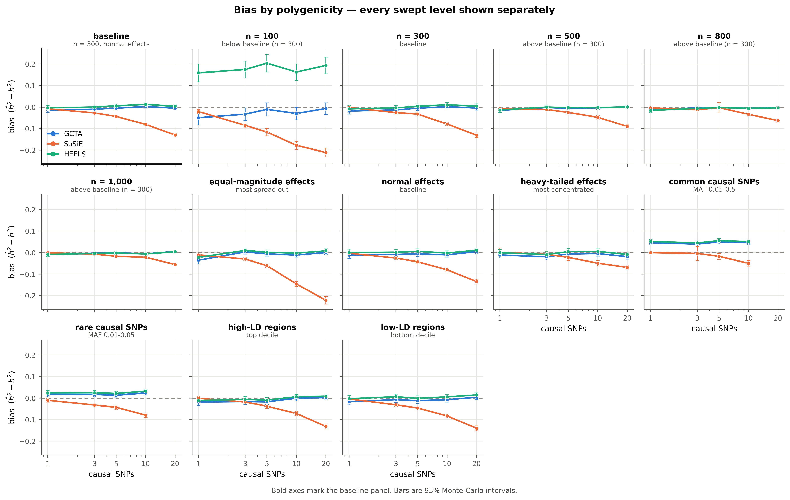

---

## 1. The switch is polygenicity, and it is specific to fine-mapping

With a **single causal SNP**, fine-mapping is essentially unbiased (-0.008, vs -0.014 for GCTA) and is closer to the truth on **70% of loci**. With **20 causal SNPs** it loses 0.13 of $h^2$ — a 40% relative shortfall at the average true $h^2$ of the grid — and wins only 21% of loci. GCTA stays flat across the whole range (-0.005 at 20 causal SNPs).

| causal SNPs | GCTA bias | SuSiE bias | HEELS bias |
|---:|---:|---:|---:|
| 1 | -0.014 | -0.008 | -0.003 |
| 3 | -0.010 | -0.028 | -0.000 |
| 5 | -0.005 | -0.044 | +0.005 |
| 10 | +0.002 | -0.081 | +0.012 |
| 20 | -0.005 | -0.130 | +0.003 |

**HEELS separates the method from the data it needs.** It is a summary-statistic estimator like SuSiE — same marginal statistics, same LD — but it fits the infinitesimal mixed model rather than a sparse one. Its bias goes -0.003 at one causal SNP to +0.003 at 20, i.e. it stays flat where fine-mapping collapses. So the polygenicity failure is **not** the price of working from summary statistics; it is the price of assuming sparsity.

The mechanism is structural, not a tuning problem. SuSiE spends a fixed budget of single-effect components on the variance it can localise; effect that is spread thinly across many variants in LD is never assigned to a credible set, and simply goes missing from $\sum(\mu^2 + \sigma^2)$. GCTA's variance component makes no attempt to localise anything, so it does not pay that penalty.

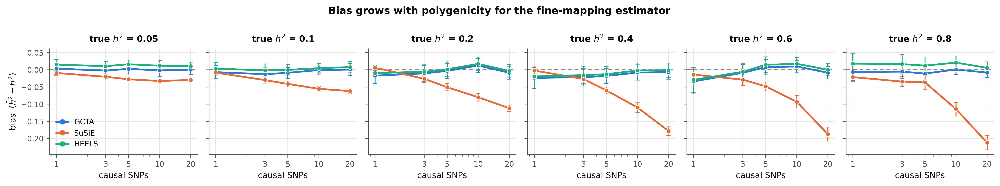

The loss is also *proportional* to $h^2$: at 20 causal SNPs the shortfall grows steadily with the true value, so this is a systematic under-recovery of signal, not a floor effect.

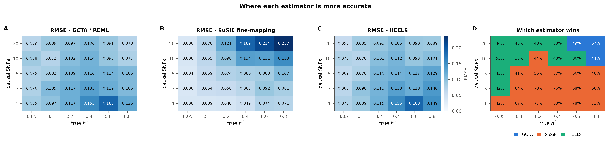

Panel C is the practical summary: fine-mapping wins the sparse, high-$h^2$ corner and loses the polygenic one.

---

## 2. What HEELS buys, and what it costs

HEELS (Li, Mazumder & Lin, *Nat Commun* 2023) estimates the same variance components REML does, but from marginal statistics plus an LD matrix instead of individual genotypes. Over the whole baseline grid:

| estimator | needs | mean bias | MAE | 95% coverage | share of loci won |
|---|---|---:|---:|---:|---:|
| GCTA | individual genotypes | -0.006 | 0.0813 | 87% | 24% |
| SuSiE | sumstats + LD | -0.058 | 0.0742 | 68% | 47% |
| HEELS | sumstats + LD | +0.003 | 0.0820 | 89% | 30% |

HEELS lands on GCTA's accuracy (+0.003 against -0.006, MAE 0.082 against 0.081) without ever seeing an individual's genotype. For a consortium that can share summary statistics but not individual-level data, that is the practical headline of this study.

**This near-identity is expected, and that is the point.** For the model both fit, the pair (X'y, X'X) — marginal statistics and in-sample LD — are *sufficient statistics* for the individual-level likelihood; Woodbury's identity turns one into the other. So HEELS recovering REML is not a surprise to be marvelled at, it is a confirmation that the implementation is correct. What is genuinely useful is the corollary: **nothing is lost by sharing summary statistics instead of genotypes**, as long as the LD is in-sample. (The two are not bit-identical — GCTA maximises the restricted likelihood and HEELS the plain one — which is why their biases differ slightly.)

**The catch is the LD matrix, and it is not negotiable.** HEELS's residual-variance update is `s2e = y'y/n - S'b/n`, which stays non-negative only because `S' R^+ S = y' P_X y <= y'y` when R is the LD of the *same* individuals the statistics came from. Hand it a reference-panel LD and the bound is simply false: on one 1000G region with p = 893, n = 300 and a 503-person panel we measured `S' R^+ S = 1383` against `y'y = 300`, and the iteration diverges within a few steps. Every HEELS number here therefore uses in-sample LD.

That makes one comparison in this report asymmetric and worth stating plainly: SuSiE was run in the legacy `panel` configuration, so **HEELS sees a better-specified LD matrix than SuSiE does**. Some of the gap between the two summary-statistic methods is that difference rather than the sparsity assumption. The `ld_for_susie=sim` run would put them on equal footing and has not been done.

So the practically interesting question is not whether HEELS matches REML on in-sample LD — it must — but what happens when the LD is *not* in-sample, which is the situation every consortium actually faces. In our regime the answer is that it does not degrade gracefully; it diverges. That is a sharper limitation than the paper emphasises, and it is specific to p > n: with n >> p the quadratic form stays bounded and the method behaves.

**Cost.** Measured at 0.015 s per model fit against 11.8 s for SuSiE and 0.12 s for GCTA — roughly 800x cheaper than fine-mapping. The implementation maximises the profile likelihood directly rather than running the published alternating iteration, which lands on the same fixed point but crawls near the h2 -> 0 boundary (one locus still read 0.098 after 200 iterations against a converged 0.067).

---

## 3. The same result, as distributions rather than means

Everything above is a mean with a Monte-Carlo interval, which is the right summary for bias and the wrong one for everything else. These are the underlying distributions over replicate loci — one group per true heritability, one box per estimator, median solid and **mean dashed** so skew is visible where the two separate.

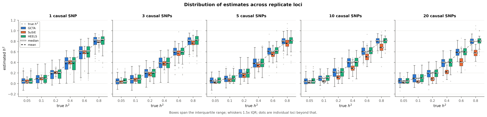

The dashed grey trace is the truth. Read left to right: at one causal SNP all three boxes straddle it; by 20 the orange boxes have slid wholesale below, while blue and green stay put. That downward slide is the entire finding of §1, without any averaging.

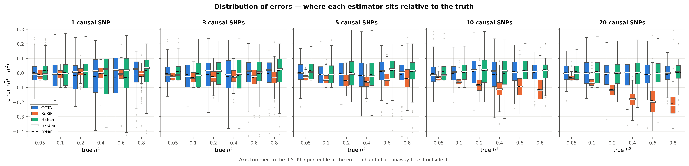

Centring on the truth shows what the bias numbers cannot: **fine-mapping trades variance for bias, and at high polygenicity it loses both bets.** At 1 causal SNP its boxes are by far the tightest — an inter-quartile spread of 0.056 against 0.158 for GCTA and 0.147 for HEELS. That precision is the reason it wins so often in the sparse corner. By 20 causal SNPs the box has both slid down *and* widened to 0.149, overtaking GCTA's 0.120: it ends up more biased **and** more variable than the estimator it was meant to improve on.

GCTA and HEELS behave almost identically here, as they must — spreads of 0.120 and 0.109 at 20 causal SNPs — with HEELS marginally the tighter of the two across the grid.

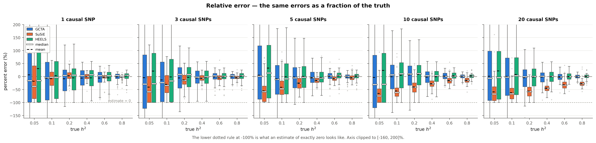

Rescaling by the truth exposes the one regime where **no** estimator is usable. At $h^2$ = 0.05 every box spans roughly ±100%: an absolute error of 0.03 looks negligible on the previous panel and is a 60% miss here. The lower dotted rule marks what an estimate of exactly zero looks like, and SuSiE's box sits on it for much of the low-$h^2$ grid.

The practical reading: **absolute bias is the wrong yardstick for low-heritability genes**, and most genes are low-heritability genes.

---

## 4. Sample size — the one thing that repairs the bias

Sample size moves the fine-mapping bias more than any other axis tested. Going **below** baseline is punishing and going **above** it helps, monotonically:

| *n* | direction | GCTA bias | SuSiE bias | HEELS bias | GCTA MAE | SuSiE MAE | HEELS MAE | SuSiE wins |
|---:|---|---:|---:|---:|---:|---:|---:|---:|
| 100 | below baseline (n = 300) | -0.026 | -0.122 | +0.179 | 0.205 | 0.142 | 0.300 | 45% |
| 300 | baseline | -0.008 | -0.054 | +0.001 | 0.078 | 0.072 | 0.079 | 47% |
| 500 | above baseline (n = 300) | -0.005 | -0.037 | -0.004 | 0.054 | 0.055 | 0.054 | 47% |
| 800 | above baseline (n = 300) | -0.005 | -0.023 | -0.007 | 0.046 | 0.045 | 0.046 | 51% |
| 1,000 | above baseline (n = 300) | -0.003 | -0.021 | -0.004 | 0.044 | 0.039 | 0.043 | 50% |

> **Read MAE, not RMSE, in this table.** SuSiE's RMSE at *n* = 800 (0.113) breaks the trend because of a *single* cell where the fit returned $\hat h^2$ = 4.5 (absolute error 3.7). MAE is monotone across the whole sweep — 0.142 → 0.072 → 0.055 → 0.045 → 0.039 — and is the honest summary here. See §8.

Fine-mapping's bias shrinks 6-fold from *n* = 100 (-0.122) to *n* = 1,000 (-0.021): with more samples the marginal signal is sharp enough for SuSiE to resolve, so less effect goes unassigned.

But **bias and usefulness move in opposite directions.** At *n* = 100 — where SuSiE's bias is at its worst — its error is 31% *smaller* than GCTA's (MAE 0.142 vs 0.205) and it wins 45% of loci, because REML is very noisy in small samples. By *n* = 1,000 the bias is nearly gone, but so is the advantage: only 11% better on MAE (0.039 vs 0.044) and 50% of loci. **Fine-mapping is most worth using exactly where it is most biased.** It trades REML's variance for its own bias, and that trade pays only while REML is noisy.

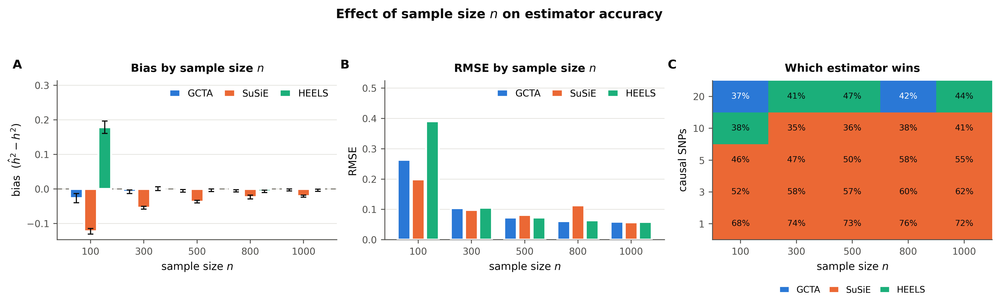

---

## 5. Effect concentration — not effect *size*

A clarification, because the axis name invites the wrong reading: the three effect-size priors do **not** carry different amounts of genetic effect. Causal effects are rescaled so that $\beta' R \beta = h^2$ exactly in every arm, so total effect is identical by construction. What changes is how that fixed total is **spread across the causal SNPs**:

| prior | how the effect is distributed |
|---|---|
| equal-magnitude (`fixed`) | every causal SNP identical — maximally spread |
| normal (`normal`) | varied magnitudes — the baseline |
| heavy-tailed (`pareto`) | one or two dominate — maximally concentrated |

(Effect *magnitude* is already covered twice elsewhere: total magnitude is the $h^2$ axis, and per-causal-SNP magnitude is $\sqrt{h^2/k}$, i.e. the causal-count axis.)

| prior | concentration | SuSiE bias | HEELS bias | GCTA bias | SuSiE bias at 20 causal | SuSiE wins |
|---|---|---:|---:|---:|---:|---:|
| equal-magnitude effects | most spread out | -0.094 | -0.001 | -0.010 | -0.222 | 35% |
| normal effects | baseline | -0.058 | +0.003 | -0.006 | -0.135 | 46% |
| heavy-tailed effects | most concentrated | -0.030 | -0.002 | -0.012 | -0.069 | 54% |

This is the same mechanism as §1, seen along a second axis. Concentration is what fine-mapping can exploit: with heavy-tailed effects it recovers most of the signal (-0.030) and wins 54% of loci; with equal-magnitude effects spread evenly it is at its worst (-0.094) and drops to 35% — the only condition tested where GCTA is preferable on average. GCTA is indifferent to the prior (-0.010 vs -0.012), as expected.

Practically: **20 causal SNPs of equal size is a near-worst case** (-0.222), while 20 causal SNPs dominated by one or two is much more benign (-0.069). The count of causal variants alone does not predict the error — how the effect is distributed among them matters just as much.

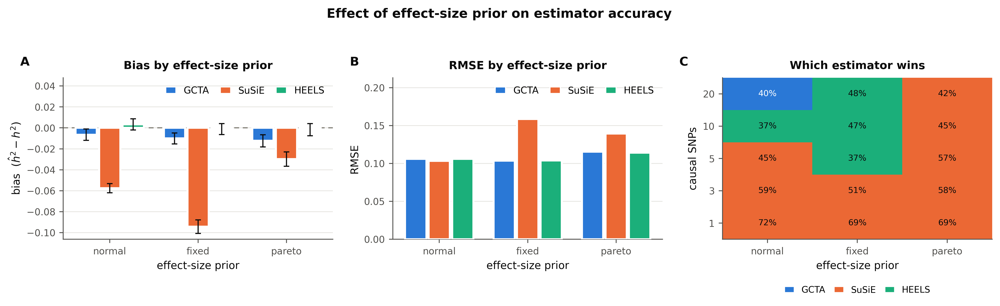

---

## 6. Causal allele frequency — the one place GCTA breaks

Every other condition leaves GCTA near-unbiased. Restricting causal variants to a frequency bin does not:

| causal SNPs drawn from | GCTA bias | SuSiE bias | HEELS bias | SuSiE wins |
|---|---:|---:|---:|---:|
| common causal SNPs (MAF 0.05-0.5) | **+0.045** | -0.018 | +0.051 | 53% |
| rare causal SNPs (MAF 0.01-0.05) | **+0.018** | -0.042 | +0.025 | 51% |

GCTA turns **upward**-biased (+0.045 for common causal variants) — the only sign flip anywhere in the study. The GRM here weights all variants equally, which implicitly assumes effect size is unrelated to allele frequency; when causal variants are confined to one frequency bin that assumption is false and the variance component is mis-attributed. This is the known GCTA MAF/LD-stratification issue, and it is the argument for MAF-stratified GRMs (GREML-LDMS) rather than a single GRM.

Worth flagging because it is invisible in the other campaigns: the benchmark itself is not unconditionally trustworthy, so "SuSiE differs from GCTA on real data" cannot be read as "SuSiE is wrong" without knowing the frequency architecture.

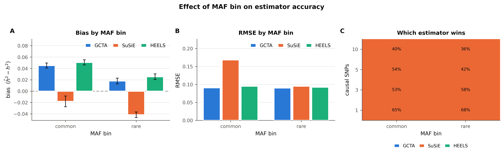

---

## 7. LD architecture — much less important than expected

| regions | GCTA bias | SuSiE bias | HEELS bias | SuSiE wins |
|---|---:|---:|---:|---:|
| low-LD regions (bottom decile) | -0.008 | -0.061 | +0.004 | 46% |
| high-LD regions (top decile) | -0.010 | -0.053 | -0.002 | 48% |
| unselected (baseline) | -0.006 | -0.058 | +0.003 | 47% |

Top- versus bottom-decile LD separates the fine-mapping bias by only 0.009 — an order of magnitude less than the causal-count axis, and less than moving *n* from 300 to 500. LD is the thing fine-mapping is built to resolve, and on this evidence it resolves it: what defeats the estimator is signal being *diffuse*, not signal being *correlated*.

One caveat on the size of this contrast. The LD score used here is the fraction of sampled SNP pairs with $r^2 \ge 0.8$, and across 300 random ±500 kb windows it is tightly distributed (median 0.0024, p90 0.0051, max 0.0109). Top and bottom deciles of a narrow distribution are not a dramatic contrast; a stronger test would select on LD-block structure directly rather than on this scalar.

---

## 8. The estimators fail in different ways

A heritability outside $[0, 1]$ is not a heritability. Both estimators produce them, at very different rates and severities:

| condition | GCTA out of range | SuSiE out of range | HEELS out of range | worst SuSiE error |
|---|---:|---:|---:|---:|
| baseline | 7.9% | 0.2% | 0.0% | 0.48 |
| *n* = 100 | 22.2% | 0.1% | 0.0% | 1.46 |
| *n* = 300 | 7.2% | 0.2% | 0.0% | 0.48 |
| *n* = 500 | 4.0% | 0.2% | 0.0% | 0.97 |
| *n* = 800 | 2.2% | 0.3% | 0.0% | 3.69 |
| *n* = 1,000 | 0.9% | 0.2% | 0.0% | 0.42 |

**GCTA fails often but mildly.** With `--reml-no-constrain`, REML is free to return a negative variance component, and at *n* = 100 it does so on 22% of fits. These are small negatives around a true $h^2$ near zero — statistically well-behaved, and the standard reason not to truncate them before averaging.

**SuSiE fails rarely but catastrophically.** It goes out of range on well under 1% of fits, but when it does the estimate can be 3–4× larger than any possible heritability — while reporting clean convergence and a credible set with PIP ≈ 1. This is the rank-deficient panel LD (~8,200 SNPs, 503 reference individuals) letting the IBSS fit run away. It is the same failure mode that `susie_rss`'s `check_prior` guard catches in its severe form, in a milder version that slips past.

**HEELS sits between them.** Its heritability is a ratio of two non-negative variance components, so it cannot leave [0, 1] by construction; instead it fails by pinning at the boundary (0.0% of the baseline grid lands outside the range, which is only the tolerance edge). A boundary estimate is reported with `status = at_h2_bound` rather than silently, so it can be filtered.

Consequences worth acting on: **report MAE alongside RMSE** (a handful of runaway fits dominate a squared-error summary), and **screen fine-mapping $h^2$ estimates against $[0, 1]$** in any production run rather than trusting the convergence flag. `tables/` and `conditions.csv` carry `frac_impossible` and `max_abs_err` for every condition.

### Interval coverage

Nominal 95% intervals cover the truth 87% of the time for GCTA and 68% for SuSiE. They fail for opposite reasons:

- **GCTA** reports standard errors that are honest in shape but slightly too small relative to the spread actually seen across replicate loci.
- **SuSiE**'s analytic SE, $\sqrt{\sum \mathrm{Var}(\beta_j^2)}$ under a normal posterior, is *larger* than the empirical spread at low $h^2$ — yet coverage there is worst, because the interval is centred on a badly biased point estimate. A wide interval around the wrong number still misses.

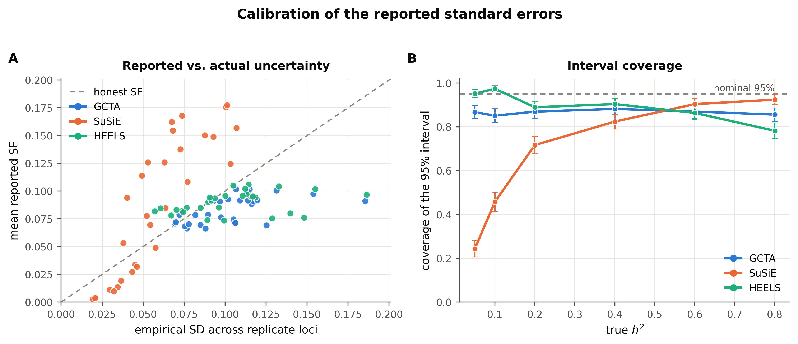

The practical consequence: the SuSiE SE should not be used for inference or meta-analysis weighting as it stands. It quantifies posterior uncertainty about the effects it found, not uncertainty about the effects it missed — and the effects it missed are the whole problem.

---

## 9. What this implies for real data

| situation | use | why |
|---|---|---|
| **No individual-level data** | **HEELS** | matches REML's accuracy from summary statistics alone — provided the LD is in-sample |
| Summary statistics, LD from a *reference panel* | **SuSiE** | HEELS diverges outright on mismatched LD; fine-mapping tolerates it |
| Small eQTL study (*n* ≲ 300) | **SuSiE**, expect downward bias | REML variance dominates; SuSiE has ~30% lower MAE despite the bias |
| Large study (*n* ≳ 800) | **either**, GCTA if unbiasedness matters | the two converge; SuSiE keeps a small residual downward bias |
| Sparse architecture expected | **SuSiE** | 70% win rate at one causal variant |
| Polygenic *cis* architecture | **GCTA or HEELS** | both are flat across polygenicity; SuSiE loses ~0.13 of $h^2$ at 20 causal SNPs |
| Frequency-stratified architecture | **neither, unmodified** | GCTA turns upward-biased; use a MAF-stratified GRM |
| Any reported $h^2$ standard error | **do not trust as-is** | coverage is 68–87%, not 95% |
| Any fine-mapping $h^2$ in production | **screen against [0, 1]** | rare runaway fits report clean convergence |

The general point: on real data the two estimators disagree most for polygenic, low-heritability genes — and that disagreement is *predictable* in size and direction, so it can be corrected for rather than treated as noise.

---

## 10. What would change these conclusions

Four limitations that are deliberate, not oversights:

1. **SuSiE was given the raw reference-panel LD** (`ld_for_susie: panel`), matching the legacy pipeline. With ~8,200 SNPs and 503 reference individuals that matrix is rank-deficient. Some of the measured bias may therefore be LD mis-specification rather than the estimator itself. The `sim` setting hands SuSiE the exact LD the genotypes were drawn from and separates the two; that run has not been done.
2. **SuSiE saw ~15% fewer SNPs than GCTA.** The legacy allele QC (`legacy_ambiguous_filter: true`) drops strand-ambiguous A/T and C/G variants. Sumstats and reference come from the same `.bim` here, so there is nothing to disambiguate and the filter is a small unearned handicap.
3. **Simulated genotypes are multivariate normal**, not real genotypes. LD structure is preserved; MAF spectrum and haplotype structure are not. The GTEx pass is the check on this.
4. **HEELS and SuSiE were not given the same LD.** HEELS requires in-sample LD or it diverges; SuSiE ran with the legacy reference panel. The two summary-statistic methods are therefore not on equal footing, and `ld_for_susie=sim` is the run that would fix it.
5. **The p/n regime is far outside HEELS's published setting.** The paper works at n >> p (UK Biobank); here p/n is roughly 20-30. On synthetic data HEELS degrades gracefully over that range rather than breaking (bias up to ~0.05 at p/n = 7), but its published accuracy guarantees do not transfer directly.

Both of the first two are one-line config changes; each costs about 25 minutes of compute.

---

## 11. Reproduction and cost

Against the previous pipeline's `result_eur_num_people_100_300_regular_LD.txt`, the rebuilt engine reproduces cell means with correlation **0.9987** (GCTA) and **0.9995** (SuSiE); 93% and 100% of the 30 design cells fall within two Monte-Carlo standard errors, i.e. the difference is sampling noise.

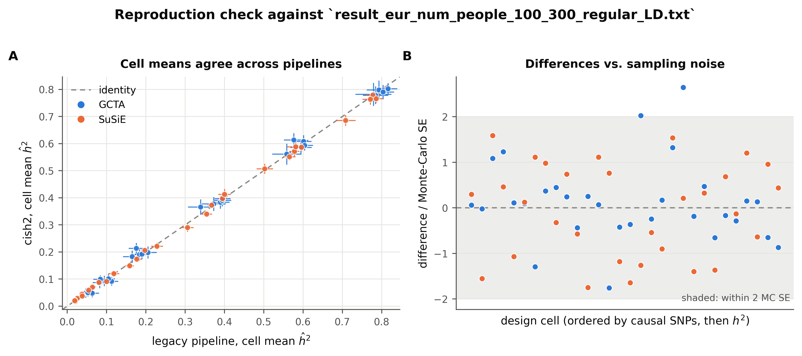

Cost is **18.2 s of single-core work per model fit** at a median region size of ~8,200 SNPs, so the whole study above is roughly **103 core-hours** — about 3.5 hours of wall time on 48 workers. Cost scales as $p^{2.0}$ in the number of SNPs in the window and is essentially flat in sample size.

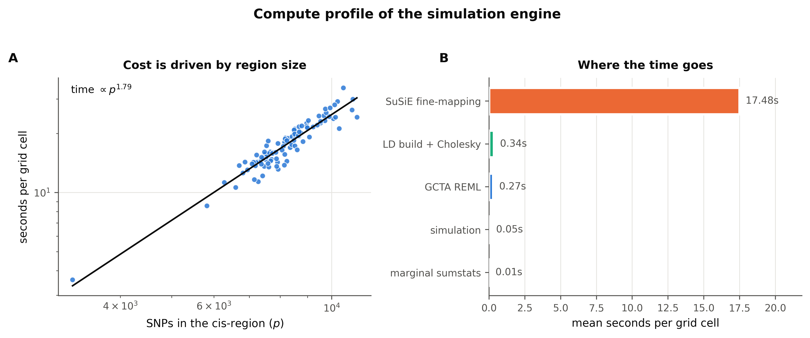

---

Per-condition numbers: [`conditions.csv`](conditions.csv). Per-campaign detail: [`OVERVIEW.md`](OVERVIEW.md) and each campaign's `REPORT.md`. Pipeline documentation: [`cish2/README.md`](../cish2/README.md).

Generated by `python -m analysis.findings`; every number is read from the result tables at build time.
