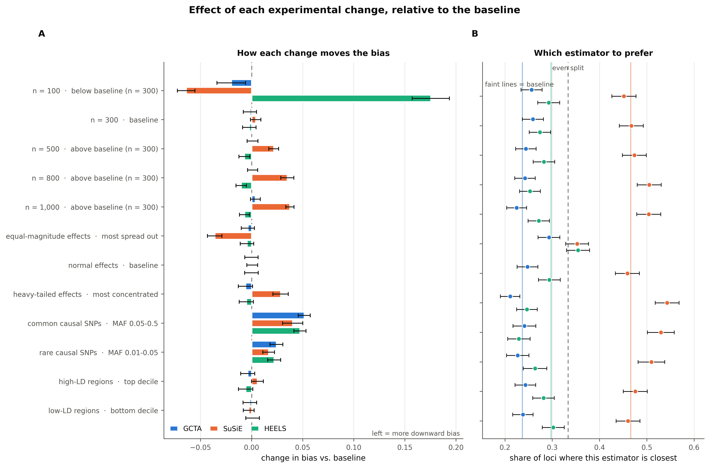

# cis-heritability benchmark — all conditions

6 campaigns, **13 experimental conditions**, 20,294 grid cells over 350 simulated cis-regions.

Every swept level is its own row: a sample-size sweep contributes one row per *n* with its direction relative to the baseline, never a single averaged "sample size" entry.

## Conditions

| group | condition | direction | cells | GCTA bias | SuSiE bias | SuSiE bias, sparse (1 causal SNP) | SuSiE bias, polygenic (20 causal) | SuSiE wins |
|---|---|---|---:|---:|---:|---:|---:|---:|
| baseline | baseline **←** | n = 300, normal effects | 2,990 | -0.0063 | -0.0582 | -0.0080 | -0.1302 | 47% |
| sample size | n = 100 | below baseline (n = 300) | 1,464 | -0.0263 | -0.1222 | -0.0210 | -0.2116 | 45% |
| sample size | n = 300 | baseline | 1,490 | -0.0080 | -0.0542 | -0.0024 | -0.1310 | 47% |
| sample size | n = 500 | above baseline (n = 300) | 1,495 | -0.0054 | -0.0366 | -0.0076 | -0.0903 | 47% |
| sample size | n = 800 | above baseline (n = 300) | 1,499 | -0.0053 | -0.0233 | -0.0037 | -0.0631 | 51% |
| sample size | n = 1,000 | above baseline (n = 300) | 1,500 | -0.0026 | -0.0207 | -0.0009 | -0.0557 | 50% |
| effect concentration | equal-magnitude effects | most spread out | 1,495 | -0.0100 | -0.0943 | -0.0108 | -0.2220 | 35% |
| effect concentration | normal effects | baseline | 1,491 | -0.0065 | -0.0576 | -0.0032 | -0.1349 | 46% |
| effect concentration | heavy-tailed effects | most concentrated | 1,494 | -0.0123 | -0.0298 | +0.0007 | -0.0693 | 54% |
| causal MAF | common causal SNPs | MAF 0.05-0.5 | 1,199 | +0.0452 | -0.0180 | -0.0002 | -0.0502 | 53% |
| causal MAF | rare causal SNPs | MAF 0.01-0.05 | 1,199 | +0.0179 | -0.0415 | -0.0106 | -0.0798 | 51% |
| LD architecture | high-LD regions | top decile | 1,485 | -0.0102 | -0.0525 | -0.0011 | -0.1319 | 48% |
| LD architecture | low-LD regions | bottom decile | 1,493 | -0.0081 | -0.0610 | -0.0045 | -0.1403 | 46% |

## Campaigns (provenance)

| campaign | regions | cells | median p | axes swept | LD to SuSiE |
|---|---:|---:|---:|---|---|
| [baseline_n300](baseline_n300/REPORT.md) | 100 | 2,990 | 8,175 | ncausal, h2_true | `panel` |
| [effect_size](effect_size/REPORT.md) | 50 | 4,480 | 8,416 | ncausal, h2_true, effect_dist | `panel` |
| [high_ld](high_ld/REPORT.md) | 50 | 1,485 | 8,043 | ncausal, h2_true | `panel` |
| [low_ld](low_ld/REPORT.md) | 50 | 1,493 | 10,140 | ncausal, h2_true | `panel` |
| [maf_arch](maf_arch/REPORT.md) | 50 | 2,398 | 8,316 | ncausal, h2_true, maf_bin | `panel` |
| [sample_size](sample_size/REPORT.md) | 50 | 7,448 | 8,335 | n, ncausal, h2_true | `panel` |

Each campaign has its own `REPORT.md`, `tables/*.csv` and `figures/*.pdf`. The narrative walk-through is in [FINDINGS.md](FINDINGS.md).

---

Generated by `python -m analysis.overview`.
