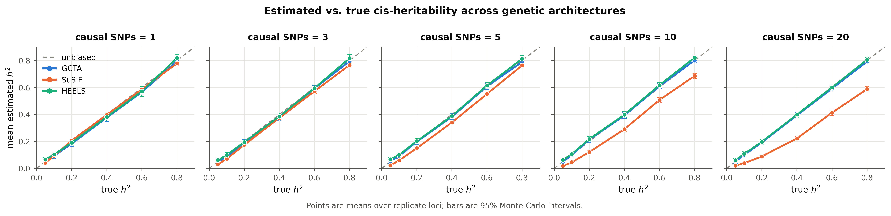
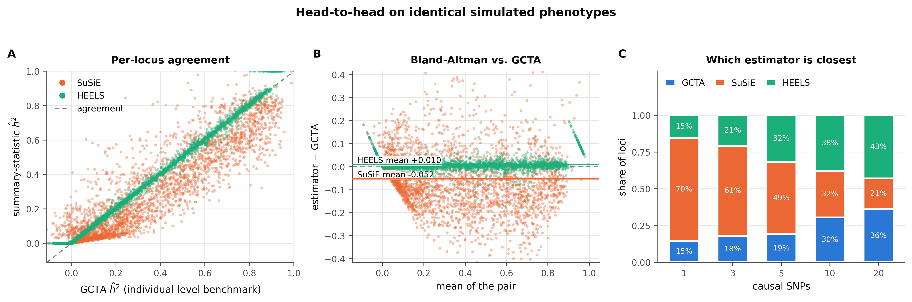

# cis-heritability benchmark - `baseline_n300`

- **cells analysed:** 2,990 across 100 independent cis-regions
- **region size:** median 8,176 SNPs (range 3,254-11,150)
- **design axes varying:** ncausal, h2_true
- **LD handed to SuSiE:** `panel`

## Headline

| estimator | mean bias | RMSE | 95% coverage | corr. with truth |
|---|---:|---:|---:|---:|
| GCTA | -0.0063 ± 0.0038 | 0.1061 | 86.6% | 0.931 |
| SuSiE | -0.0582 ± 0.0030 | 0.1020 | 67.9% | 0.951 |
| HEELS | +0.0034 ± 0.0039 | 0.1080 | 89.4% | 0.930 |

### Bias by causal-SNP count

| causal SNPs | GCTA bias | SuSiE bias | HEELS bias | GCTA wins | SuSiE wins | HEELS wins |
|---|---:|---:|---:|---:|---:|---:|
| 1 | -0.0140 | -0.0080 | -0.0035 | 15% | 70% | 15% |
| 3 | -0.0100 | -0.0276 | -0.0001 | 18% | 61% | 21% |
| 5 | -0.0050 | -0.0440 | +0.0054 | 19% | 49% | 32% |
| 10 | +0.0023 | -0.0807 | +0.0119 | 30% | 32% | 38% |
| 20 | -0.0050 | -0.1302 | +0.0035 | 36% | 21% | 43% |

### Convergence and attrition

| estimator | cells | failed | % | main reasons |
|---|---:|---:|---:|---|
| GCTA | 3,000 | 10 | 0.33% | An error occurs, please check the options or data (10) |
| SuSiE | 3,000 | 0 | 0.00% | - |
| HEELS | 3,000 | 0 | 0.00% | - |
| retries | 3,000 | 0 | 0.00% | cells needing >1 simulation attempt |

### Cost

- mean **18.24 s per grid cell** at median p = 8,176
- total simulated compute: **15.15 core-hours**

## Figures

### fig1 accuracy grid

### fig2 bias by polygenicity

### fig3 rmse landscape

### fig4 calibration

### fig5 head to head

### fig7 compute profile

### figD1 estimate distributions

### figD2 error distributions

### figD3 relative error

## Tables

- `tables/attrition.csv`
- `tables/metrics_by_grid.csv`
- `tables/metrics_overall.csv`
- `tables/paired_tests_by_ncausal.csv`
- `tables/timing_by_region.csv`
- `tables/win_rate_by_grid.csv`

---

Generated by `cish2` - see `cish2/README.md` for the pipeline description.
