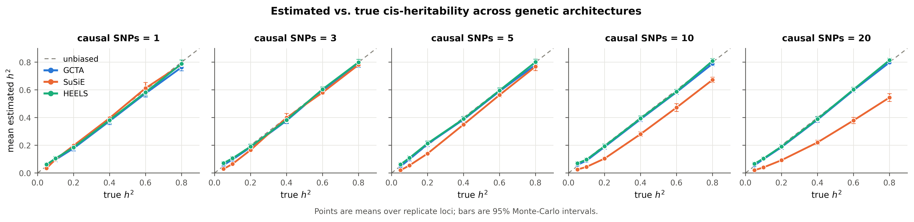
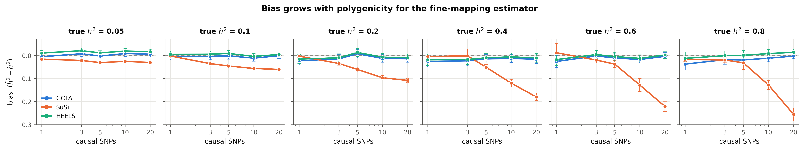
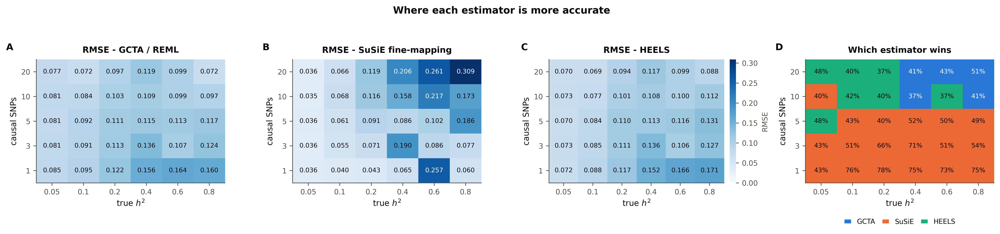
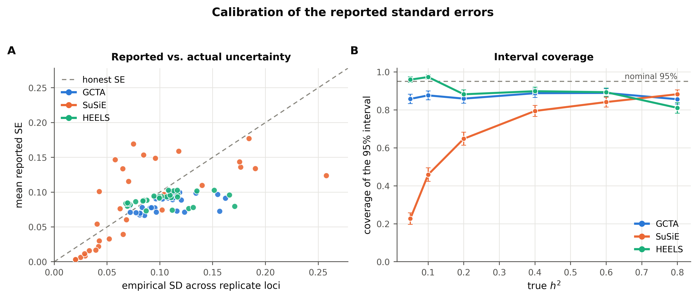
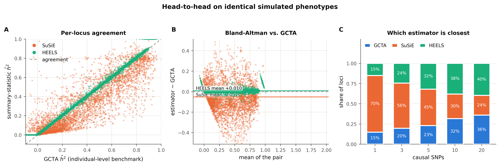
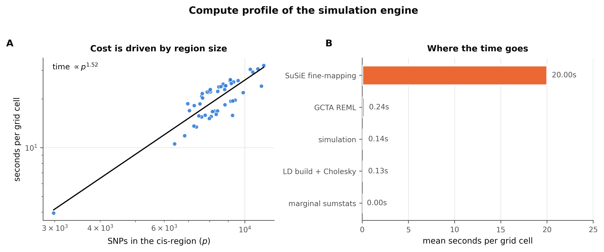
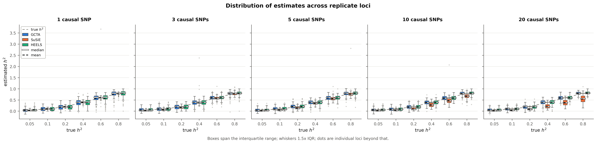
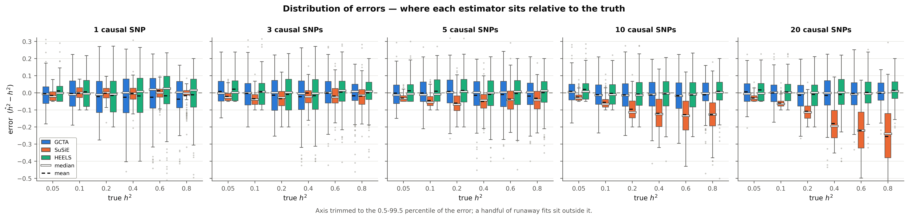
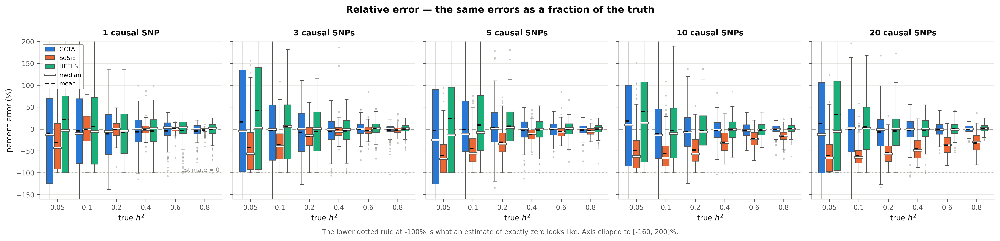
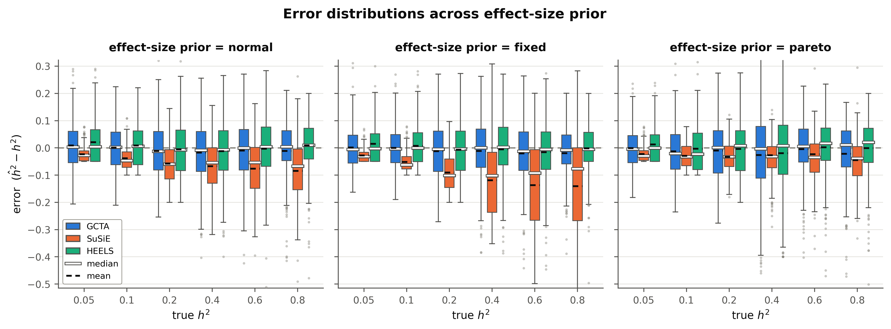

# cis-heritability benchmark - `effect_size`

- **cells analysed:** 4,480 across 50 independent cis-regions
- **region size:** median 8,416 SNPs (range 2,980-11,271)
- **design axes varying:** ncausal, h2_true, effect_dist
- **LD handed to SuSiE:** `panel`

## Headline

| estimator | mean bias | RMSE | 95% coverage | corr. with truth |
|---|---:|---:|---:|---:|
| GCTA | -0.0096 ± 0.0032 | 0.1085 | 87.1% | 0.927 |
| SuSiE | -0.0606 ± 0.0036 | 0.1358 | 64.3% | 0.902 |
| HEELS | +0.0001 ± 0.0032 | 0.1081 | 90.3% | 0.927 |

### Bias by causal-SNP count

| causal SNPs | GCTA bias | SuSiE bias | HEELS bias | GCTA wins | SuSiE wins | HEELS wins |
|---|---:|---:|---:|---:|---:|---:|
| 1 | -0.0198 | -0.0045 | -0.0076 | 15% | 70% | 15% |
| 3 | -0.0084 | -0.0214 | +0.0009 | 20% | 56% | 24% |
| 5 | -0.0062 | -0.0423 | +0.0038 | 23% | 45% | 32% |
| 10 | -0.0090 | -0.0920 | +0.0002 | 32% | 30% | 38% |
| 20 | -0.0047 | -0.1422 | +0.0034 | 36% | 24% | 40% |

### Convergence and attrition

| estimator | cells | failed | % | main reasons |
|---|---:|---:|---:|---|
| GCTA | 4,500 | 20 | 0.44% | An error occurs, please check the options or data (20) |
| SuSiE | 4,500 | 0 | 0.00% | - |
| HEELS | 4,500 | 0 | 0.00% | - |
| retries | 4,500 | 0 | 0.00% | cells needing >1 simulation attempt |

### Cost

- mean **20.58 s per grid cell** at median p = 8,416
- total simulated compute: **25.61 core-hours**

## Figures

### fig1 accuracy grid

### fig2 bias by polygenicity

### fig3 rmse landscape

### fig4 calibration

### fig5 head to head

### fig6 axis effect dist

### fig7 compute profile

### figD1 estimate distributions

### figD2 error distributions

### figD3 relative error

### figD4 boxplots effect dist

## Tables

- `tables/attrition.csv`
- `tables/metrics_by_effect_dist.csv`
- `tables/metrics_by_grid.csv`
- `tables/metrics_overall.csv`
- `tables/paired_tests_by_ncausal.csv`
- `tables/timing_by_region.csv`
- `tables/win_rate_by_grid.csv`

---

Generated by `cish2` - see `cish2/README.md` for the pipeline description.
