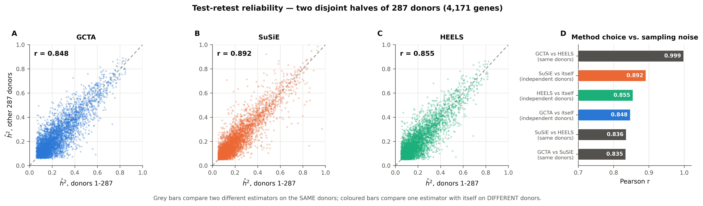

# Test-retest reliability on disjoint donor halves

GTEx Whole Blood donors split into two **disjoint** halves of 287, each analysed independently end to end. No donor contributes to both estimates, so half-A versus half-B is an honest reliability coefficient rather than the self-similarity nested subsamples produce.

Reported on **4,171 genes** with $\hat h^2$ > 0.05 in every estimator in both halves — a common set, so the three are compared on identical genes and nobody is helped by a pile of estimates sitting at zero.

| estimator | Pearson | Spearman | ICC | RMSD | median &#124;A−B&#124; |
|---|---:|---:|---:|---:|---:|
| GCTA | **0.848** | 0.737 | 0.848 | 0.0852 | 0.0515 |
| SuSiE | **0.892** | 0.803 | 0.892 | 0.0772 | 0.0402 |
| HEELS | **0.855** | 0.737 | 0.855 | 0.0773 | 0.0454 |

**SuSiE is the most reliable estimator** on every measure. That is a real result and it must be read carefully, because **reliability systematically favours the more shrunken estimator**: an estimator that returned a constant would score a perfect ICC and be worthless. The simulations show SuSiE is the shrunken one — its inter-quartile error spread is a third of GCTA's at low polygenicity — so high reliability is exactly what its bias predicts, not evidence against it.

Reliability answers *precision*. It cannot, on its own, answer *accuracy*; only the simulations can, and there SuSiE is the biased arm.

## The comparison that reframes the question

| comparison | Pearson r |
|---|---:|
| GCTA vs SuSiE, **same** donors | 0.835 |
| GCTA vs HEELS, **same** donors | 0.999 |
| SuSiE vs HEELS, **same** donors | 0.836 |
| GCTA vs itself, **different** donors | 0.848 |
| SuSiE vs itself, **different** donors | 0.892 |
| HEELS vs itself, **different** donors | 0.855 |

**GCTA and HEELS are one method by this measure.** They agree at r = 0.999 on the same donors, against GCTA's own across-donor reliability of 0.848 — the method difference is more than an order of magnitude smaller than the sampling noise. Choosing between them on real data is not a meaningful decision; the sufficiency result from the simulations says it never could be.

**SuSiE is a genuinely different measurement, but only just.** It agrees with GCTA at r = 0.835 on the same donors, essentially the same as GCTA's agreement with *itself* on different donors (0.848). So the SuSiE-versus-GCTA difference is of the same order as donor sampling noise at this sample size — detectable in aggregate over ~4,000 genes, but not something to act on for any single gene.

## What this licenses, and what it does not

**Licensed:** at this sample size, no pair of these estimators differs by more than donor sampling noise. A paper claiming one is better on GTEx Whole Blood alone would be over-reading; the simulations, where truth is known, are what carry that claim.

**Not licensed:** "they are all equivalent". They are equivalent *on average over genes at this n*. The simulations locate exactly where they are not — polygenic, non-localisable architecture — and the discordant tail of real genes is enriched for precisely that.

For completeness, the same table over **all** genes (including the boundary pile, which is why these numbers differ):

| estimator | Pearson | Spearman | ICC | RMSD | genes |
|---|---:|---:|---:|---:|---:|
| GCTA | 0.865 | 0.604 | 0.865 | 0.0636 | 18,504 |
| SuSiE | 0.913 | 0.660 | 0.913 | 0.0491 | 18,504 |
| HEELS | 0.872 | 0.603 | 0.872 | 0.0550 | 18,504 |

---

Generated by `python -m analysis.reliability`.
