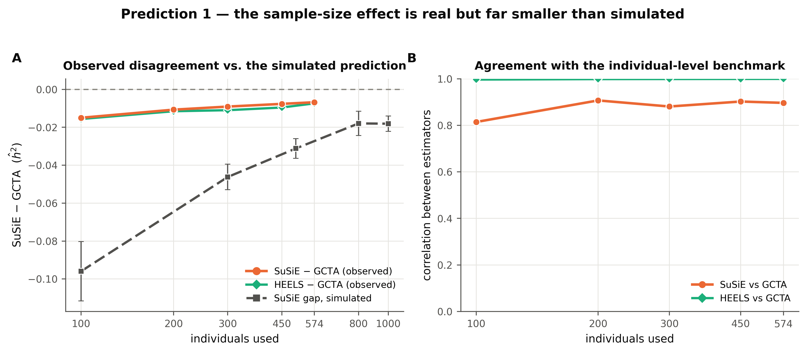
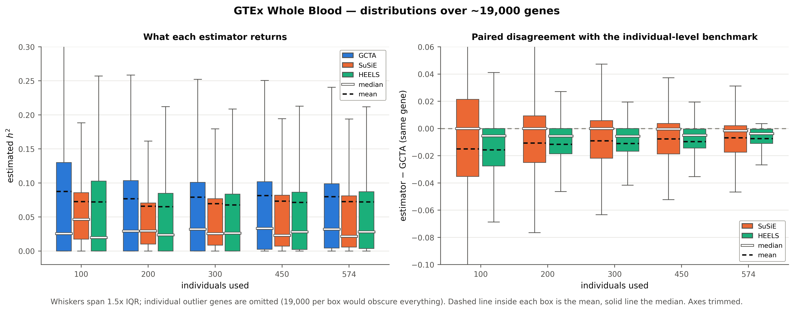
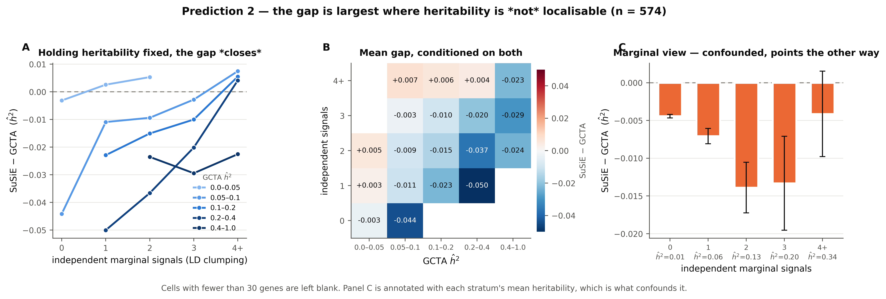
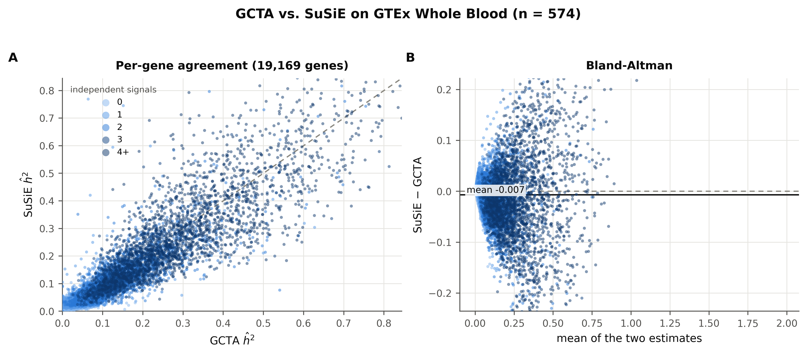
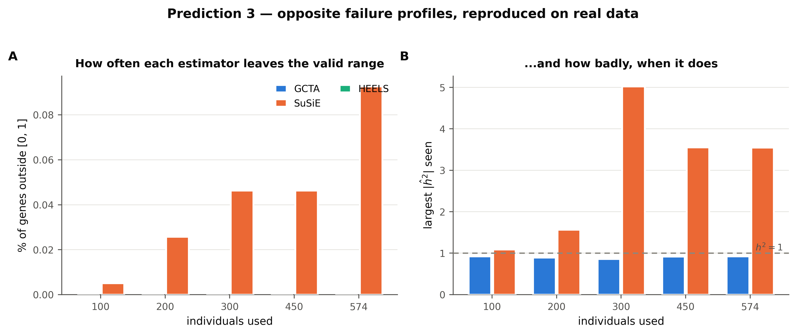

# GTEx Whole Blood — do the simulated patterns hold in real data?

**19,432 genes**, GTEx v8 EUR, HapMap3 genotypes, 574 individuals with expression, genotype and covariates. Each gene is fitted at five nested sample sizes (100, 200, 300, 450, 574), so the sample-size axis is paired down to the individual.

Expression **and** genotypes are residualised on genotype PCs, inferred expression factors, sex, platform and PCR batch, with the factor count following GTEx's own sample-size rule. LD is in-sample — the same individuals that produced the summary statistics — so unlike the simulations there is no reference-panel mismatch.

> There is no ground truth here, so **nothing below measures bias**. Everything is the *disagreement* `estimator − GCTA`. A match to prediction is consistency, not proof: GCTA is not a gold standard either.

### A correction to an earlier version of this analysis

An earlier run pre-residualised the expression on covariates and handed REML the residual, which hides the degrees of freedom the covariates consume. That inflated GCTA's estimates — badly at small *n*, where 24 covariates eat a quarter of the data — and manufactured most of an apparent gap that appeared to close with sample size. **That result was an artefact.** REML now receives the covariates as fixed effects via `--qcovar`, and the numbers below supersede it.

Two consequences of doing it properly, both documented in the config: unconstrained REML then fails to converge on 60-75% of genes, so this pass uses GCTA's default *constrained* REML (about 2% attrition); and GCTA can therefore no longer return a negative heritability, which removes the asymmetry that Prediction 3 relied on.

---

## Prediction 1 — the gap should close as sample size grows

**Confirmed in direction, but the effect is small.** The gap does shrink monotonically with sample size, yet it is tiny throughout — a few thousandths of $h^2$ — so this is a weak version of the simulated result rather than a striking one.

| individuals | genes | GCTA $\hat{h}^2$ | SuSiE $\hat{h}^2$ | HEELS $\hat{h}^2$ | SuSiE $-$ GCTA | HEELS $-$ GCTA | corr(SuSiE,GCTA) | corr(HEELS,GCTA) |
|---:|---:|---:|---:|---:|---:|---:|---:|---:|
| 100 | 19,162 | 0.0877 | 0.0727 | 0.0721 | **-0.0150** | **-0.0156** | 0.814 | 0.997 |
| 200 | 19,126 | 0.0769 | 0.0662 | 0.0653 | **-0.0107** | **-0.0115** | 0.907 | 0.999 |
| 300 | 18,824 | 0.0792 | 0.0702 | 0.0683 | **-0.0091** | **-0.0110** | 0.881 | 0.999 |
| 450 | 18,747 | 0.0816 | 0.0739 | 0.0720 | **-0.0076** | **-0.0096** | 0.902 | 0.999 |
| 574 | 19,169 | 0.0798 | 0.0730 | 0.0724 | **-0.0068** | **-0.0074** | 0.897 | 1.000 |

The gap narrows 2-fold from -0.0150 at n = 100 to -0.0068 at n = 574, and the SuSiE-GCTA correlation rises from 0.81 to 0.90. The direction matches the simulation; the magnitude does not.

Quantitatively, against the simulated prediction:

| n | simulation predicts | GTEx observes |
|---:|---:|---:|
| 100 | -0.096 | -0.015 |
| 300 | -0.046 | -0.009 |
| 500 | -0.031 | — |
| 800 | -0.018 | — |
| 1000 | -0.018 | — |

The direction agrees, but **the real gap is roughly 6x smaller than the simulation predicts** (-0.015 observed against -0.096 predicted at n = 100). The simulations are not wrong; they describe a regime this data is not in.

Two differences explain it, and both say the simulated grid is harsher than Whole Blood. First, the simulated architectures are deliberately polygenic — up to 20 causal SNPs carrying equal weight — whereas most real *cis*-windows here have zero or one detectable independent signal, which is exactly the corner where the simulations say fine-mapping is fine. Second, HapMap3 gives ~365 SNPs per window against ~8,200 simulated, with *n* > *p* rather than *p* >> *n*.

The honest reading is that the simulated failure mode is **real but rarely triggered** in this tissue: the architecture that breaks fine-mapping is uncommon among Whole Blood *cis*-eQTLs, not absent.

---

## Prediction 5 — HEELS should track GCTA where SuSiE does not

**Confirmed, and more strongly than expected.** HEELS reproduces REML almost exactly on real genes: correlation **1.000** at n = 574 (and ≥ 0.997 at every sample size), with a mean difference of -0.0074. SuSiE, using the same inputs, correlates 0.90.

This is the sufficiency argument made visible. For the model both fit, the marginal statistics plus in-sample LD are *sufficient* for the individual-level likelihood, so a summary-statistic method that makes no extra assumption must land on REML — and it does, to three decimal places, on ~19,000 real genes. **Nothing is lost by sharing summary statistics instead of genotypes**, provided the LD is in-sample.

It also isolates what the remaining SuSiE-GCTA difference is *made of*. Both summary-statistic estimators see byte-identical inputs, so the gap between them is the sparsity assumption and nothing else. That gap is small here — real Whole Blood *cis*-architecture is mostly sparse enough for fine-mapping to cope — but it is the same quantity the simulations blow up by choosing harsher architectures.

The means above are what the tables report; the distributions behind them are worth seeing too, because the spread is far larger than any of the differences between estimators:

The right panel is the paired difference gene by gene — the closest real-data analogue of an error distribution, and the panel that carries the actual information.

Both boxes tighten as the sample grows, but **HEELS is about twice as tight as SuSiE at every sample size**: an inter-quartile spread of 0.0275 against 0.0566 at n = 100, narrowing to 0.0105 against 0.0195 at n = 574. The two estimators see byte-identical inputs, so that factor of two is the sparsity assumption showing up as **variance** — gene-to-gene unpredictability — rather than as the bias the simulations emphasise. On real data the sparsity penalty is mostly a precision cost, not an accuracy cost.

---

## Prediction 2 — the gap should track how diffuse the signal is

**Confirmed, but only once heritability is held fixed — and the naive version of this test gives the opposite answer.**

Genes are stratified by the number of independent marginal associations found by LD clumping (p < 1e-4, r² < 0.1), a proxy that does **not** use SuSiE's output, so the test is not circular. Read marginally, it looks like the gap *grows* with the number of signals:

| independent signals | genes | mean GCTA | mean SuSiE | mean gap |
|---|---:|---:|---:|---:|
| 0 | 9,147 | 0.0109 | 0.0065 | -0.0044 |
| 1 | 4,746 | 0.0635 | 0.0565 | -0.0071 |
| 2 | 2,351 | 0.1288 | 0.1149 | -0.0139 |
| 3 | 1,219 | 0.1983 | 0.1849 | -0.0133 |
| 4+ | 1,706 | 0.3423 | 0.3382 | -0.0041 |

That reading is **confounded**: genes with more detectable signals also have far more heritability (0.02 in the first row against 0.37 in the last), so the comparison is mixing architecture with magnitude. Conditioning on heritability reverses it — within every stratum, the gap *shrinks* as detectable signals accumulate:

| independent signals | 0.0–0.05 | 0.05–0.1 | 0.1–0.2 | 0.2–0.4 | 0.4–1.0 |
|---|---:|---:|---:|---:|---:|
| 0 | -0.003 | -0.044 | — | — | — |
| 1 | +0.003 | -0.011 | -0.023 | -0.050 | — |
| 2 | +0.005 | -0.009 | -0.015 | -0.037 | -0.024 |
| 3 | — | -0.003 | -0.010 | -0.020 | -0.029 |
| 4+ | — | +0.007 | +0.006 | +0.004 | -0.023 |

Columns are GCTA $\hat{h}^2$ bins; cells with fewer than 30 genes are blank.

This is a textbook Simpson's paradox, and the conditional direction is the one that matches the simulations. The number of *detected* clumps measures how **localisable** a gene's signal is, not how polygenic it is. The worst cell in the table is the gene with real heritability and **no** detectable individual association — heritability spread too thinly to localise, which is exactly the equal-magnitude/high-polygenicity corner where the simulations put fine-mapping's largest shortfall. As signal concentrates into detectable clumps, the gap closes, matching the effect-concentration result (§3 of the simulation write-up).

Practically: a gene with a decent GCTA heritability and no genome-wide detectable *cis*-eQTL is where the two methods will disagree most, and it is precisely the gene for which fine-mapping-based $h^2$ should be distrusted.

---

## Prediction 3 — opposite failure profiles

**Not testable on this data.** The covariate fix above forced a switch to *constrained* REML, which cannot return a negative heritability, so GCTA's half of this prediction has been defined away. What remains observable is the fine-mapping half, and it behaves as predicted.

| individuals | GCTA outside [0,1] | SuSiE outside [0,1] | HEELS outside [0,1] | largest &#124;GCTA&#124; | largest &#124;SuSiE&#124; |
|---:|---:|---:|---:|---:|---:|
| 100 | 0.0% | 0.01% | 0.00% | 0.92 | 1.09 |
| 200 | 0.0% | 0.03% | 0.00% | 0.89 | 1.57 |
| 300 | 0.0% | 0.05% | 0.00% | 0.86 | 5.02 |
| 450 | 0.0% | 0.05% | 0.00% | 0.92 | 3.55 |
| 574 | 0.0% | 0.09% | 0.00% | 0.93 | 3.55 |

GCTA is pinned at 0.0% by construction here, so the columns to read are SuSiE's and HEELS's. **SuSiE fails rarely but wildly** — at most 0.09% of genes leave [0, 1], but when one does it can read 5.02, while reporting clean convergence. **HEELS never leaves the range at all**, because its heritability is a ratio of two non-negative variance components; it fails by pinning at a boundary instead, which is at least visible.

The operational advice from the simulations therefore carries over for the estimator it was about: screen fine-mapping heritabilities against [0, 1] rather than trusting the convergence flag. The claim that REML fails often-but-mildly is a property of *unconstrained* REML, and is visible in the simulations rather than here.

---

## What this does and does not establish

**On the LD asymmetry.** In these real-data runs the asymmetry that complicates the simulations disappears: genotypes and expression come from the same individuals, so *both* summary-statistic estimators get correctly specified in-sample LD. The SuSiE-versus-HEELS comparison here is therefore a clean test of the sparsity assumption, which the simulation comparison is not.

**Does:** the architecture dependence is present and clean — within a heritability stratum, the disagreement shrinks as a gene's signal becomes localisable, which is the simulations' central mechanism. And HEELS reproducing REML to a correlation of 1.000 over ~19,000 genes is a strong positive result in its own right: summary statistics plus in-sample LD lose nothing.

**Does not:** establish that the simulated *magnitudes* transfer. The sample-size effect is real but roughly six times smaller here than simulated, because Whole Blood cis-architecture is mostly sparse and the HapMap3 windows are 20x smaller than the simulated ones. The simulations describe a harsher regime than this tissue presents.

**Does not:** establish that either estimator is *correct* here. The quantity measured is disagreement, and the simulations themselves show GCTA turning upward-biased when causal variants are frequency-stratified, which is plausible in real data. A gap of -0.007 at n = 574 is consistent with SuSiE under-recovering, with GCTA over-recovering, or with both.

Three concrete limits:

1. **One tissue.** Whole Blood only, so the sample-size axis comes from subsampling rather than from tissues that genuinely differ. Subsampling holds the biology fixed, which is cleaner for the test but says nothing about tissue-to-tissue variation.
2. **A different SNP regime.** HapMap3 genotypes give a median of 365 SNPs per ±500 kb window against ~8,200 in the 1000G simulations, and here *n* > *p*, so the LD matrix is full rank. This is a **more** favourable setting for fine-mapping than the simulations used, which makes the surviving gap more notable, not less.
3. **REML attrition at small n.** 1.4% of genes have no GCTA estimate at n = 100 (against 1.4% at n = 574), and those are disproportionately the genes where REML struggled. The small-n gap is therefore measured on a slightly easier subset than the large-n gap.

---

**Companion analysis.** Accuracy cannot be measured here, but *precision* can: `../gtex_split_half/RELIABILITY.md` splits the donors into two disjoint halves and reports test-retest reliability. Headline: GCTA and HEELS agree at r = 0.999 on the same donors while GCTA agrees with itself at r = 0.848 across donors — the method difference is far below the sampling noise. SuSiE is the most reliable arm, which is what its shrinkage predicts rather than evidence of accuracy.

Tables: `tables/by_sample_size.csv`, `tables/by_clump_bin.csv`, `tables/by_credible_sets.csv`. Gene-level results: `cells.tsv.gz`. Simulation write-up: [`../FINDINGS.md`](../FINDINGS.md).

Generated by `python -m analysis.gtex_report`.
