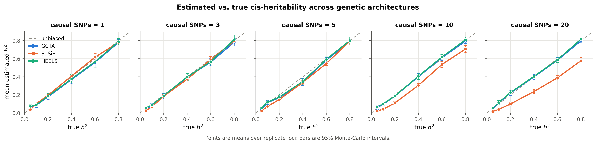
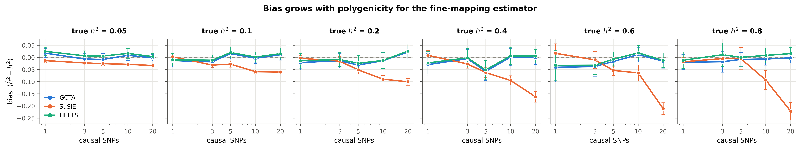
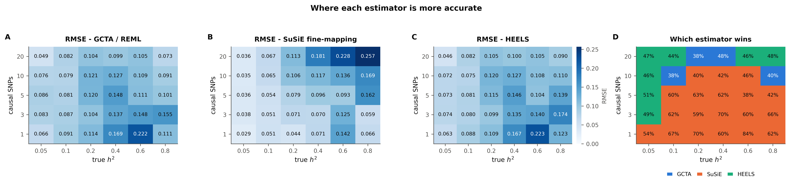
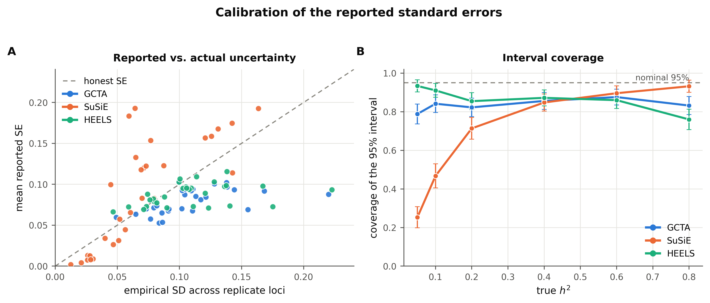
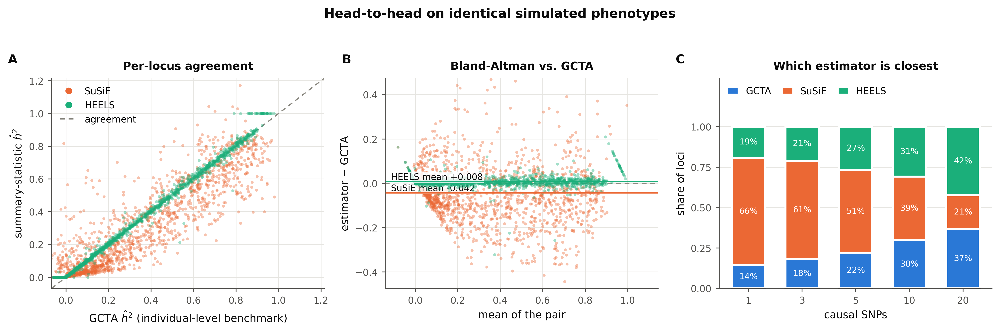
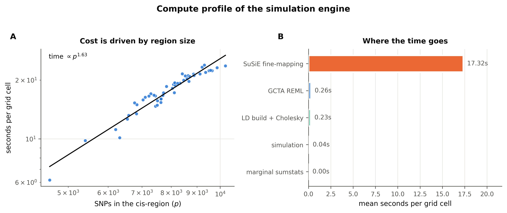
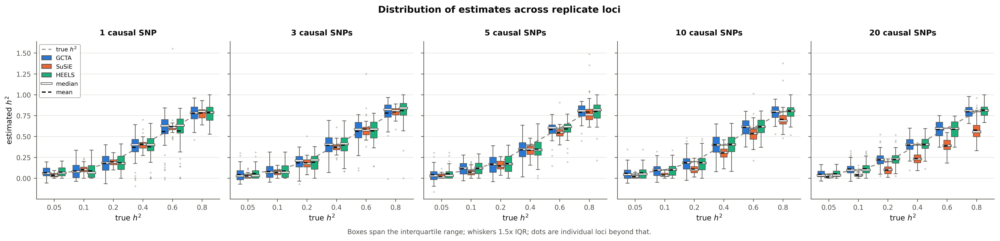
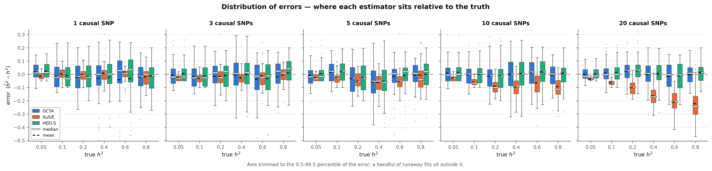
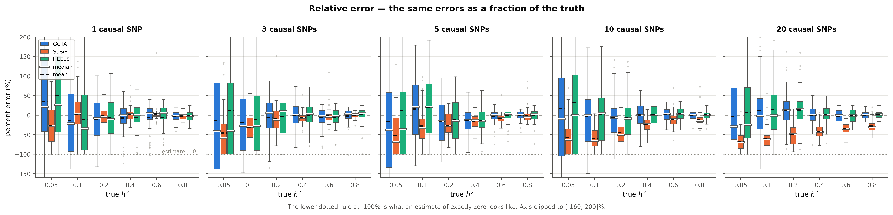

# cis-heritability benchmark - `high_ld`

- **cells analysed:** 1,485 across 50 independent cis-regions
- **region size:** median 8,043 SNPs (range 4,596-10,244)
- **design axes varying:** ncausal, h2_true
- **LD handed to SuSiE:** `panel`

## Headline

| estimator | mean bias | RMSE | 95% coverage | corr. with truth |
|---|---:|---:|---:|---:|
| GCTA | -0.0102 ± 0.0058 | 0.1139 | 83.6% | 0.920 |
| SuSiE | -0.0525 ± 0.0050 | 0.1113 | 68.8% | 0.935 |
| HEELS | -0.0024 ± 0.0059 | 0.1154 | 86.5% | 0.919 |

### Bias by causal-SNP count

| causal SNPs | GCTA bias | SuSiE bias | HEELS bias | GCTA wins | SuSiE wins | HEELS wins |
|---|---:|---:|---:|---:|---:|---:|
| 1 | -0.0183 | -0.0011 | -0.0116 | 14% | 66% | 19% |
| 3 | -0.0167 | -0.0186 | -0.0062 | 18% | 61% | 21% |
| 5 | -0.0178 | -0.0378 | -0.0096 | 22% | 51% | 27% |
| 10 | -0.0006 | -0.0719 | +0.0063 | 30% | 39% | 31% |
| 20 | +0.0022 | -0.1319 | +0.0089 | 37% | 21% | 42% |

### Convergence and attrition

| estimator | cells | failed | % | main reasons |
|---|---:|---:|---:|---|
| GCTA | 1,500 | 15 | 1.00% | An error occurs, please check the options or data (15) |
| SuSiE | 1,500 | 0 | 0.00% | - |
| HEELS | 1,500 | 0 | 0.00% | - |
| retries | 1,500 | 0 | 0.00% | cells needing >1 simulation attempt |

### Cost

- mean **18.07 s per grid cell** at median p = 8,043
- total simulated compute: **7.45 core-hours**

## Figures

### fig1 accuracy grid

### fig2 bias by polygenicity

### fig3 rmse landscape

### fig4 calibration

### fig5 head to head

### fig7 compute profile

### figD1 estimate distributions

### figD2 error distributions

### figD3 relative error

## Tables

- `tables/attrition.csv`
- `tables/metrics_by_grid.csv`
- `tables/metrics_overall.csv`
- `tables/paired_tests_by_ncausal.csv`
- `tables/timing_by_region.csv`
- `tables/win_rate_by_grid.csv`

---

Generated by `cish2` - see `cish2/README.md` for the pipeline description.
