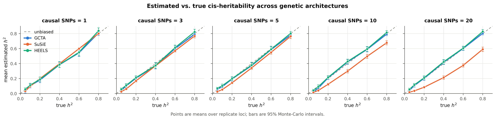
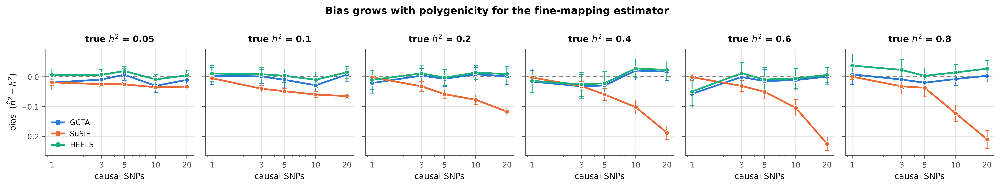
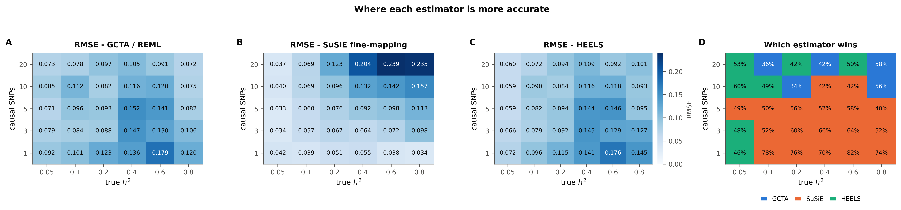
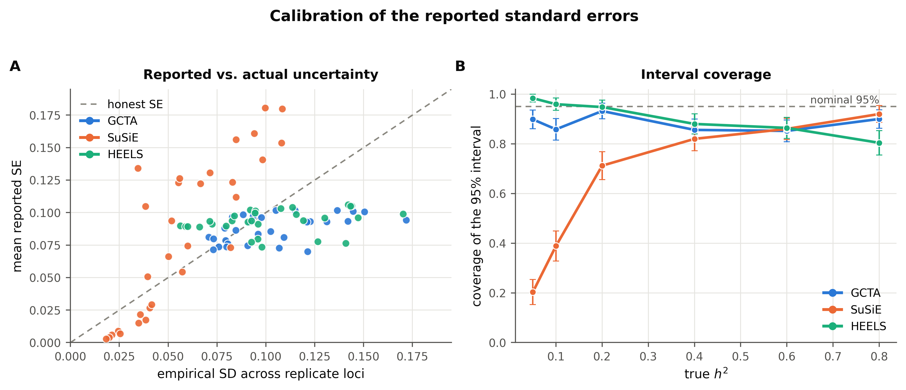
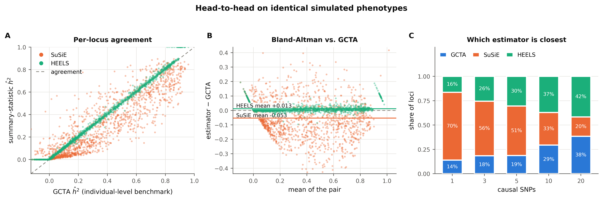
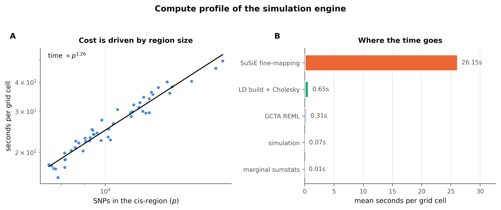
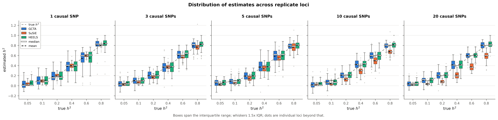
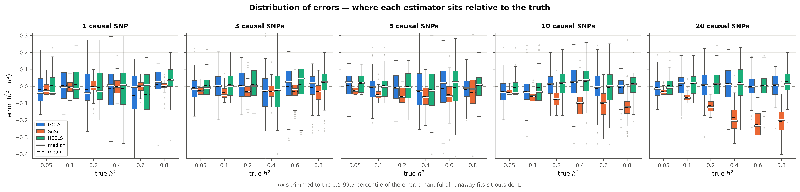
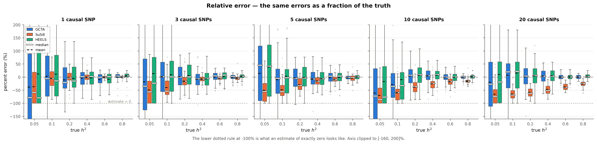

# cis-heritability benchmark - `low_ld`

- **cells analysed:** 1,493 across 50 independent cis-regions
- **region size:** median 10,140 SNPs (range 7,516-18,130)
- **design axes varying:** ncausal, h2_true
- **LD handed to SuSiE:** `panel`

## Headline

| estimator | mean bias | RMSE | 95% coverage | corr. with truth |
|---|---:|---:|---:|---:|
| GCTA | -0.0081 ± 0.0055 | 0.1077 | 88.3% | 0.930 |
| SuSiE | -0.0610 ± 0.0044 | 0.1058 | 65.2% | 0.949 |
| HEELS | +0.0045 ± 0.0054 | 0.1074 | 90.6% | 0.931 |

### Bias by causal-SNP count

| causal SNPs | GCTA bias | SuSiE bias | HEELS bias | GCTA wins | SuSiE wins | HEELS wins |
|---|---:|---:|---:|---:|---:|---:|
| 1 | -0.0168 | -0.0045 | -0.0029 | 14% | 70% | 16% |
| 3 | -0.0074 | -0.0315 | +0.0063 | 18% | 56% | 26% |
| 5 | -0.0120 | -0.0463 | -0.0012 | 19% | 51% | 30% |
| 10 | -0.0077 | -0.0833 | +0.0058 | 29% | 33% | 37% |
| 20 | +0.0037 | -0.1403 | +0.0145 | 38% | 20% | 42% |

### Convergence and attrition

| estimator | cells | failed | % | main reasons |
|---|---:|---:|---:|---|
| GCTA | 1,500 | 7 | 0.47% | An error occurs, please check the options or data (7) |
| SuSiE | 1,500 | 0 | 0.00% | - |
| HEELS | 1,500 | 0 | 0.00% | - |
| retries | 1,500 | 0 | 0.00% | cells needing >1 simulation attempt |

### Cost

- mean **27.48 s per grid cell** at median p = 10,140
- total simulated compute: **11.40 core-hours**

## Figures

### fig1 accuracy grid

### fig2 bias by polygenicity

### fig3 rmse landscape

### fig4 calibration

### fig5 head to head

### fig7 compute profile

### figD1 estimate distributions

### figD2 error distributions

### figD3 relative error

## Tables

- `tables/attrition.csv`
- `tables/metrics_by_grid.csv`
- `tables/metrics_overall.csv`
- `tables/paired_tests_by_ncausal.csv`
- `tables/timing_by_region.csv`
- `tables/win_rate_by_grid.csv`

---

Generated by `cish2` - see `cish2/README.md` for the pipeline description.
