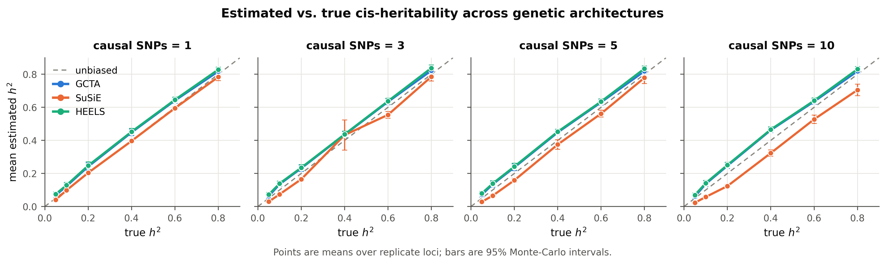
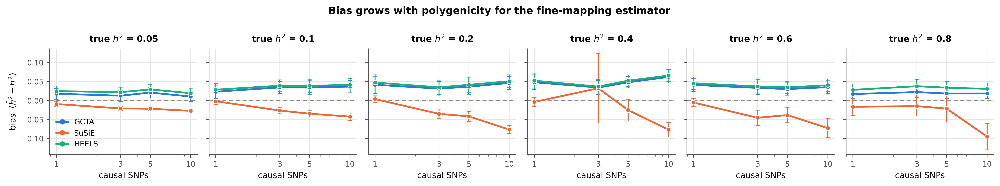
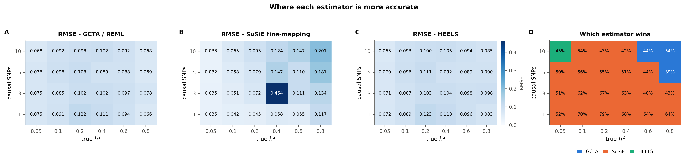
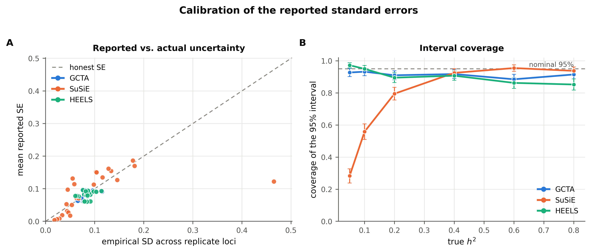
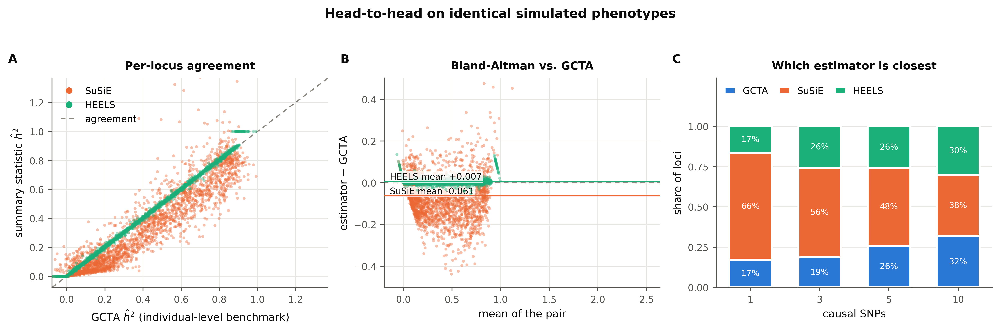
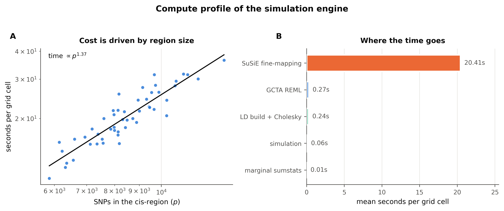
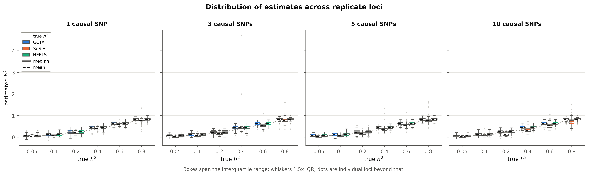
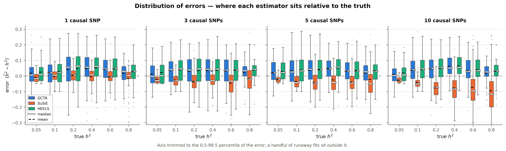
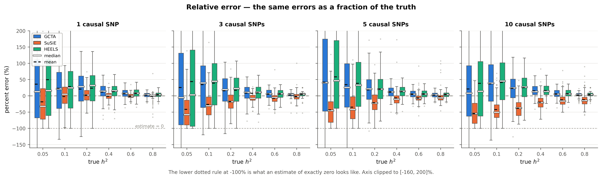
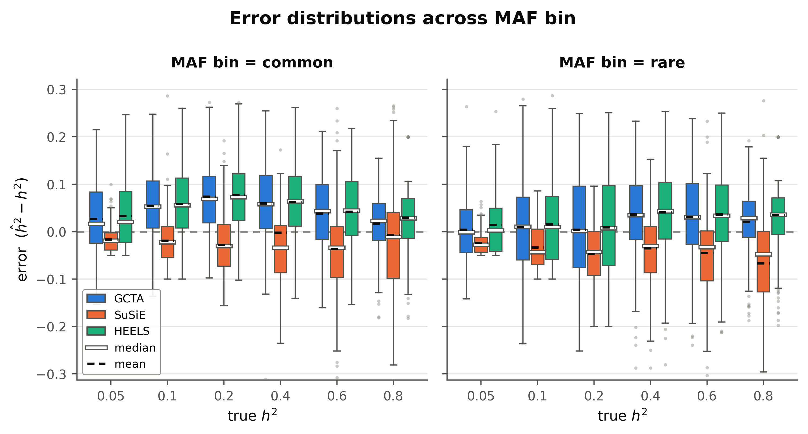

# cis-heritability benchmark - `maf_arch`

- **cells analysed:** 2,398 across 50 independent cis-regions
- **region size:** median 8,316 SNPs (range 5,856-13,493)
- **design axes varying:** ncausal, h2_true, maf_bin
- **LD handed to SuSiE:** `panel`

## Headline

| estimator | mean bias | RMSE | 95% coverage | corr. with truth |
|---|---:|---:|---:|---:|
| GCTA | +0.0316 ± 0.0034 | 0.0905 | 91.5% | 0.954 |
| SuSiE | -0.0298 ± 0.0053 | 0.1367 | 74.3% | 0.894 |
| HEELS | +0.0381 ± 0.0034 | 0.0937 | 90.7% | 0.954 |

### Bias by causal-SNP count

| causal SNPs | GCTA bias | SuSiE bias | HEELS bias | GCTA wins | SuSiE wins | HEELS wins |
|---|---:|---:|---:|---:|---:|---:|
| 1 | +0.0316 | -0.0054 | +0.0379 | 17% | 66% | 17% |
| 3 | +0.0282 | -0.0182 | +0.0347 | 19% | 56% | 26% |
| 5 | +0.0315 | -0.0303 | +0.0384 | 26% | 48% | 26% |
| 10 | +0.0350 | -0.0650 | +0.0415 | 32% | 38% | 30% |

### Convergence and attrition

| estimator | cells | failed | % | main reasons |
|---|---:|---:|---:|---|
| GCTA | 2,400 | 2 | 0.08% | An error occurs, please check the options or data (2) |
| SuSiE | 2,400 | 0 | 0.00% | - |
| HEELS | 2,400 | 0 | 0.00% | - |
| retries | 2,400 | 4 | 0.17% | cells needing >1 simulation attempt |

### Cost

- mean **21.05 s per grid cell** at median p = 8,316
- total simulated compute: **14.02 core-hours**

## Figures

### fig1 accuracy grid

### fig2 bias by polygenicity

### fig3 rmse landscape

### fig4 calibration

### fig5 head to head

### fig6 axis maf bin

### fig7 compute profile

### figD1 estimate distributions

### figD2 error distributions

### figD3 relative error

### figD4 boxplots maf bin

## Tables

- `tables/attrition.csv`
- `tables/metrics_by_grid.csv`
- `tables/metrics_by_maf_bin.csv`
- `tables/metrics_overall.csv`
- `tables/paired_tests_by_ncausal.csv`
- `tables/timing_by_region.csv`
- `tables/win_rate_by_grid.csv`

---

Generated by `cish2` - see `cish2/README.md` for the pipeline description.
