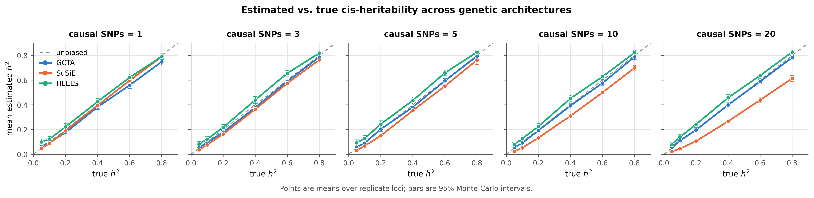
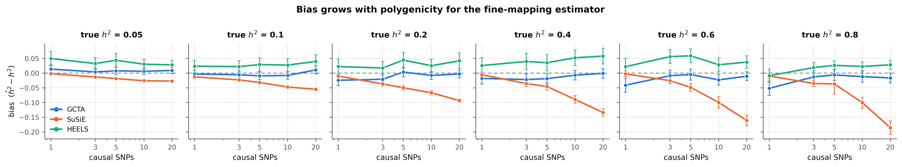
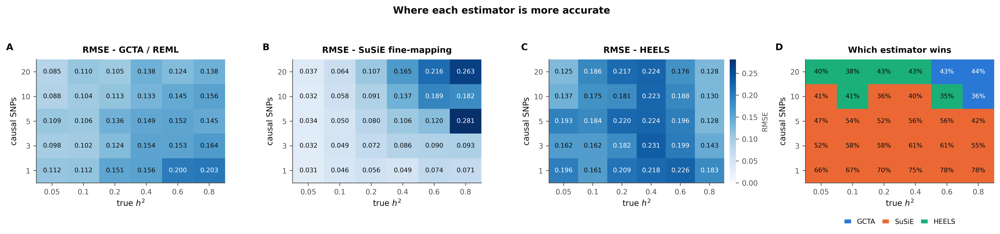
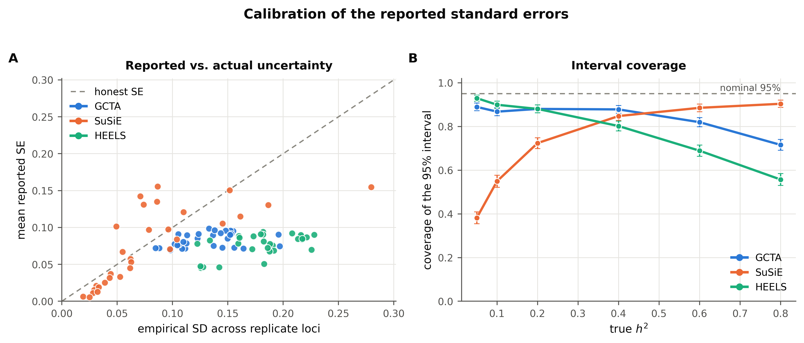
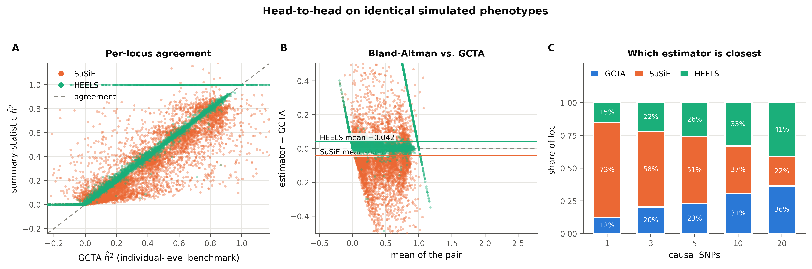
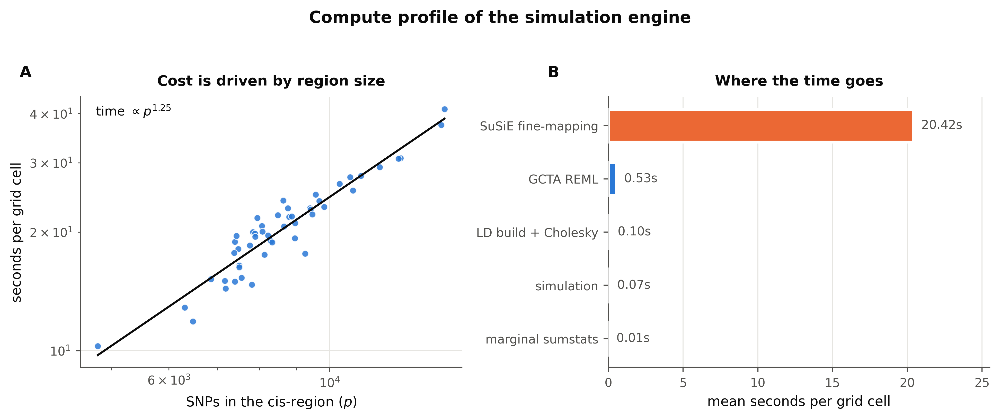
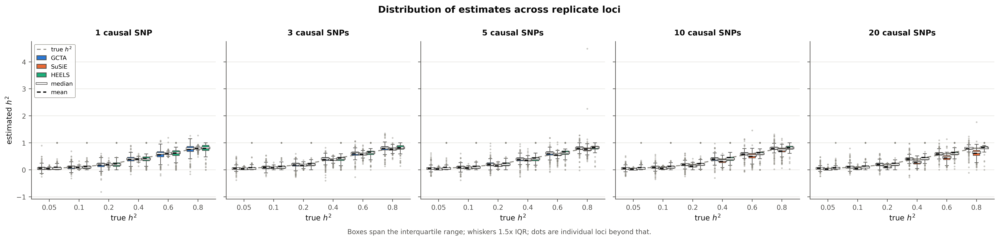
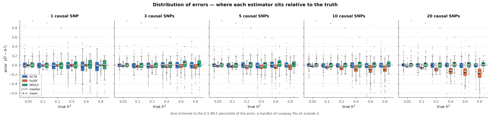
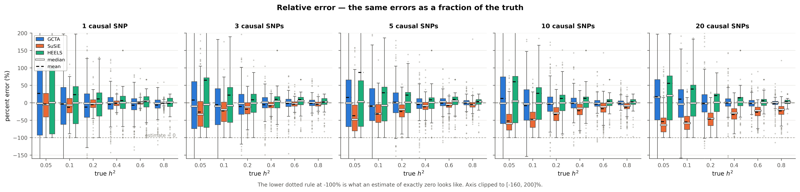
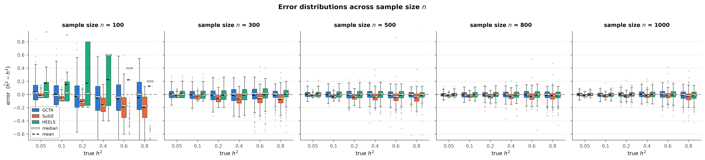

# cis-heritability benchmark - `sample_size`

- **cells analysed:** 7,448 across 50 independent cis-regions
- **region size:** median 8,335 SNPs (range 4,787-14,413)
- **design axes varying:** n, ncausal, h2_true
- **LD handed to SuSiE:** `panel`

## Headline

| estimator | mean bias | RMSE | 95% coverage | corr. with truth |
|---|---:|---:|---:|---:|
| GCTA | -0.0094 ± 0.0031 | 0.1354 | 84.2% | 0.890 |
| SuSiE | -0.0511 ± 0.0025 | 0.1196 | 71.7% | 0.922 |
| HEELS | +0.0326 ± 0.0042 | 0.1865 | 79.2% | 0.826 |

### Bias by causal-SNP count

| causal SNPs | GCTA bias | SuSiE bias | HEELS bias | GCTA wins | SuSiE wins | HEELS wins |
|---|---:|---:|---:|---:|---:|---:|
| 1 | -0.0210 | -0.0071 | +0.0222 | 12% | 73% | 15% |
| 3 | -0.0111 | -0.0283 | +0.0311 | 20% | 58% | 22% |
| 5 | -0.0047 | -0.0386 | +0.0396 | 23% | 51% | 26% |
| 10 | -0.0085 | -0.0717 | +0.0310 | 31% | 37% | 33% |
| 20 | -0.0019 | -0.1097 | +0.0389 | 36% | 22% | 41% |

### Convergence and attrition

| estimator | cells | failed | % | main reasons |
|---|---:|---:|---:|---|
| GCTA | 7,500 | 52 | 0.69% | An error occurs, please check the options or data (52) |
| SuSiE | 7,500 | 0 | 0.00% | - |
| HEELS | 7,500 | 0 | 0.00% | - |
| retries | 7,500 | 26 | 0.35% | cells needing >1 simulation attempt |

### Cost

- mean **21.24 s per grid cell** at median p = 8,335
- total simulated compute: **43.93 core-hours**

## Figures

### fig1 accuracy grid

### fig2 bias by polygenicity

### fig3 rmse landscape

### fig4 calibration

### fig5 head to head

### fig6 axis n

### fig7 compute profile

### figD1 estimate distributions

### figD2 error distributions

### figD3 relative error

### figD4 boxplots n

## Tables

- `tables/attrition.csv`
- `tables/metrics_by_grid.csv`
- `tables/metrics_by_n.csv`
- `tables/metrics_overall.csv`
- `tables/paired_tests_by_ncausal.csv`
- `tables/timing_by_region.csv`
- `tables/win_rate_by_grid.csv`

---

Generated by `cish2` - see `cish2/README.md` for the pipeline description.
