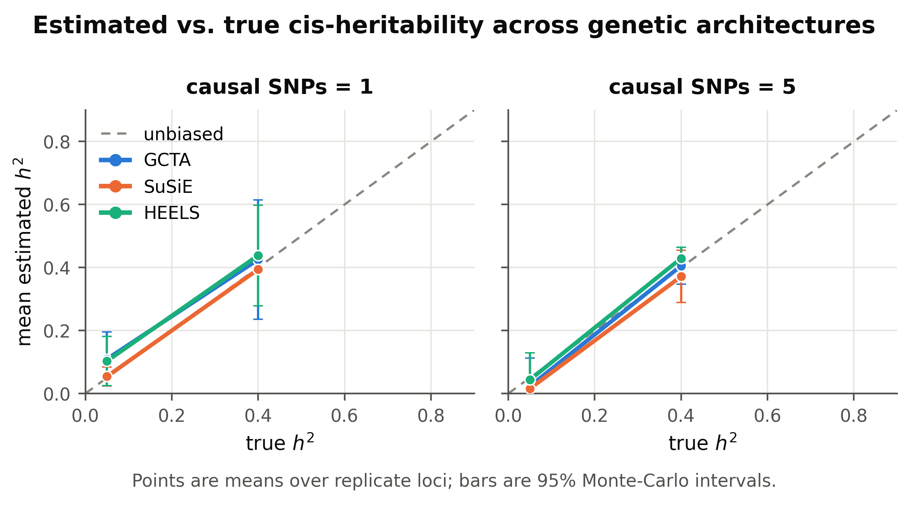
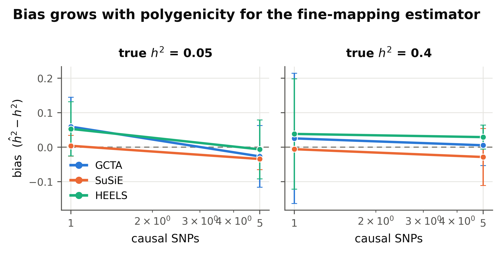
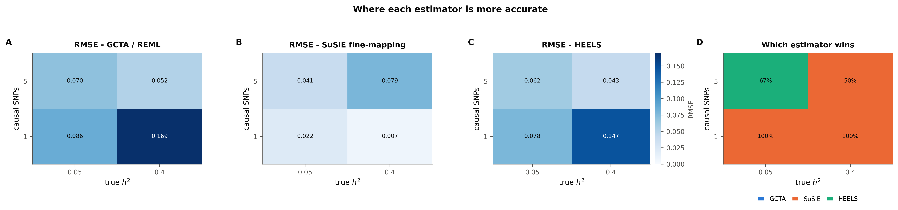
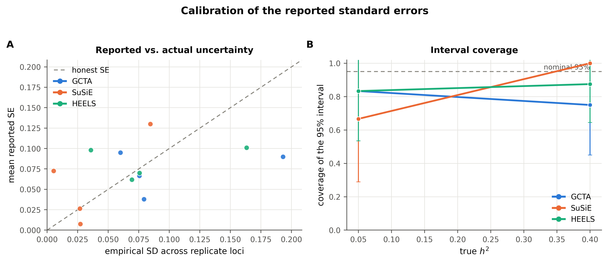
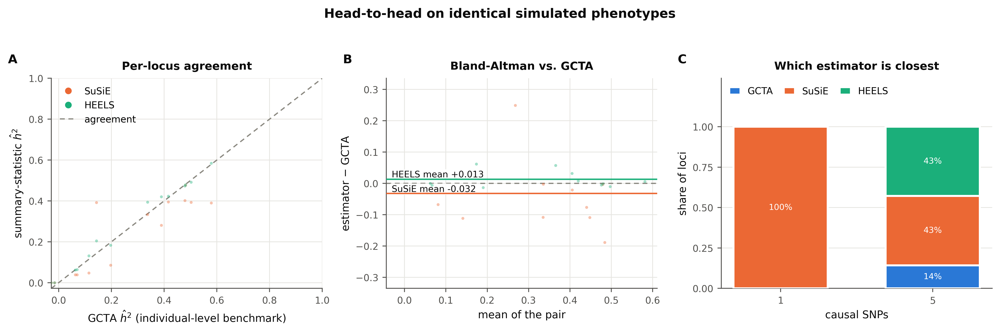
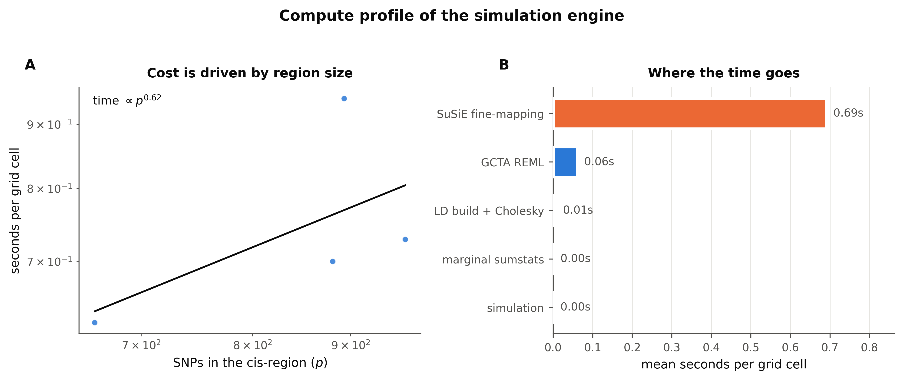
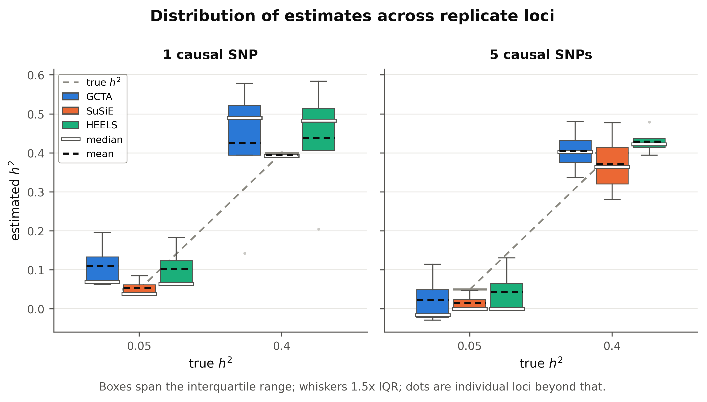
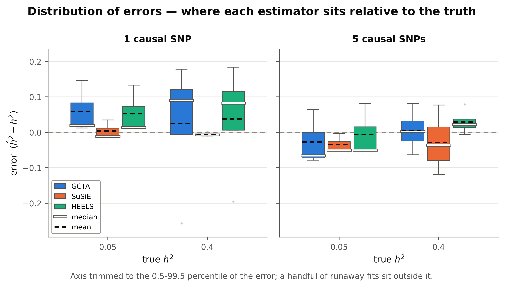
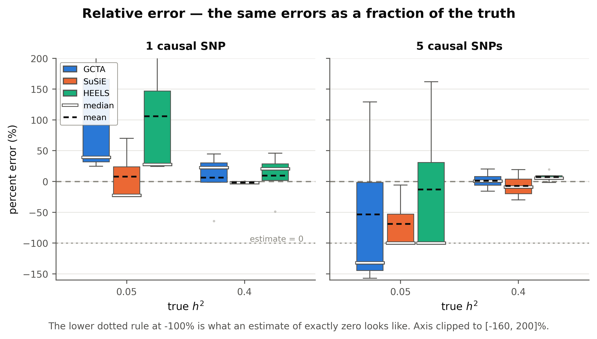

# cis-heritability benchmark - `smoke_expanse`

- **cells analysed:** 14 across 4 independent cis-regions
- **region size:** median 887 SNPs (range 662-961)
- **design axes varying:** ncausal, h2_true
- **LD handed to SuSiE:** `panel`

## Headline

| estimator | mean bias | RMSE | 95% coverage | corr. with truth |
|---|---:|---:|---:|---:|
| GCTA | +0.0159 ± 0.0579 | 0.1076 | 78.6% | 0.851 |
| SuSiE | -0.0163 ± 0.0242 | 0.0473 | 85.7% | 0.968 |
| HEELS | +0.0294 ± 0.0483 | 0.0936 | 85.7% | 0.895 |

### Bias by causal-SNP count

| causal SNPs | GCTA bias | SuSiE bias | HEELS bias | GCTA wins | SuSiE wins | HEELS wins |
|---|---:|---:|---:|---:|---:|---:|
| 1 | +0.0401 | -0.0016 | +0.0447 | 0% | 100% | 0% |
| 5 | -0.0083 | -0.0310 | +0.0140 | 14% | 43% | 43% |

### Convergence and attrition

| estimator | cells | failed | % | main reasons |
|---|---:|---:|---:|---|
| GCTA | 16 | 2 | 12.50% | An error occurs, please check the options or data (2) |
| SuSiE | 16 | 0 | 0.00% | - |
| HEELS | 16 | 0 | 0.00% | - |
| retries | 16 | 0 | 0.00% | cells needing >1 simulation attempt |

### Cost

- mean **1.16 s per grid cell** at median p = 887
- total simulated compute: **0.00 core-hours**

## Figures

### fig1 accuracy grid

### fig2 bias by polygenicity

### fig3 rmse landscape

### fig4 calibration

### fig5 head to head

### fig7 compute profile

### figD1 estimate distributions

### figD2 error distributions

### figD3 relative error

## Tables

- `tables/attrition.csv`
- `tables/metrics_by_grid.csv`
- `tables/metrics_overall.csv`
- `tables/paired_tests_by_ncausal.csv`
- `tables/timing_by_region.csv`
- `tables/win_rate_by_grid.csv`

---

Generated by `cish2` - see `cish2/README.md` for the pipeline description.
